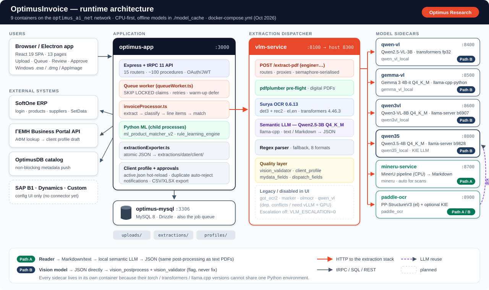
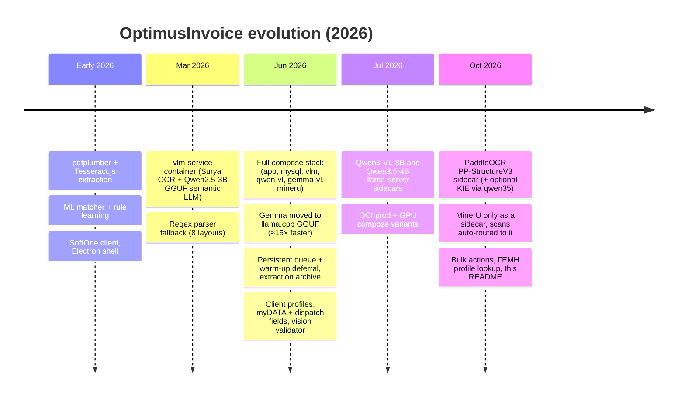
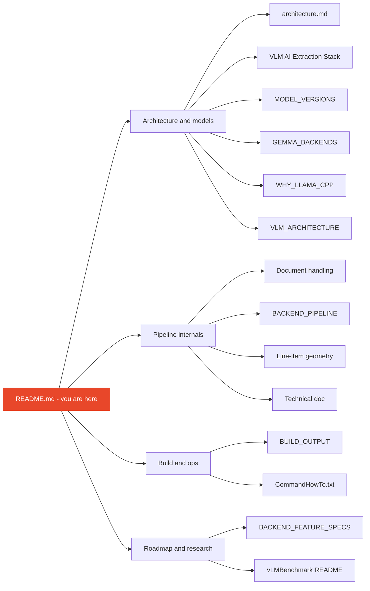
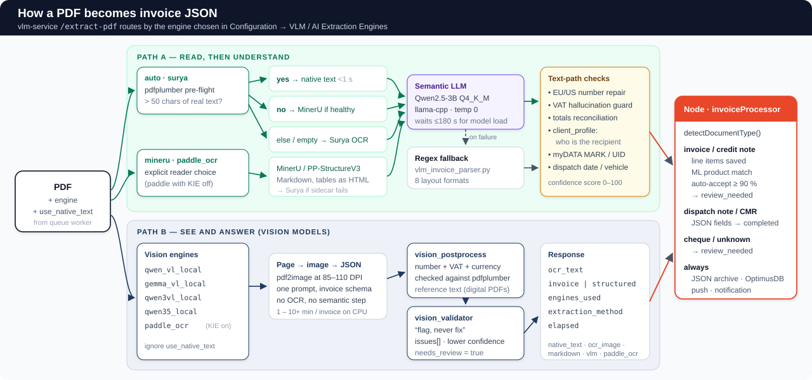
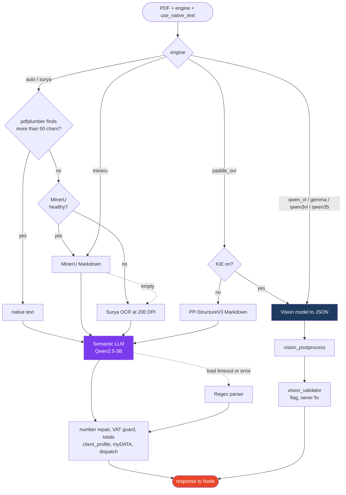
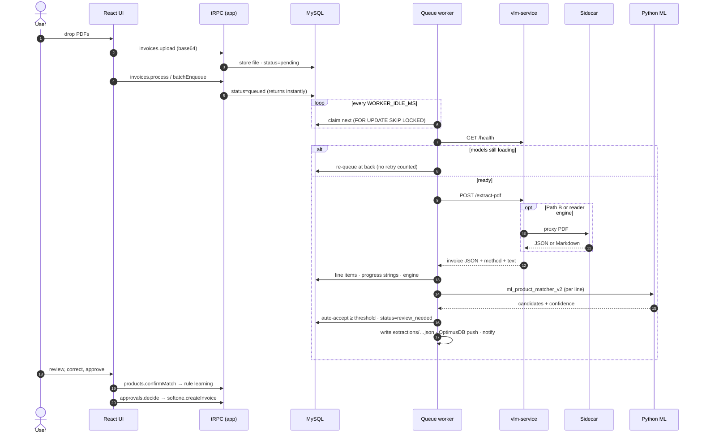
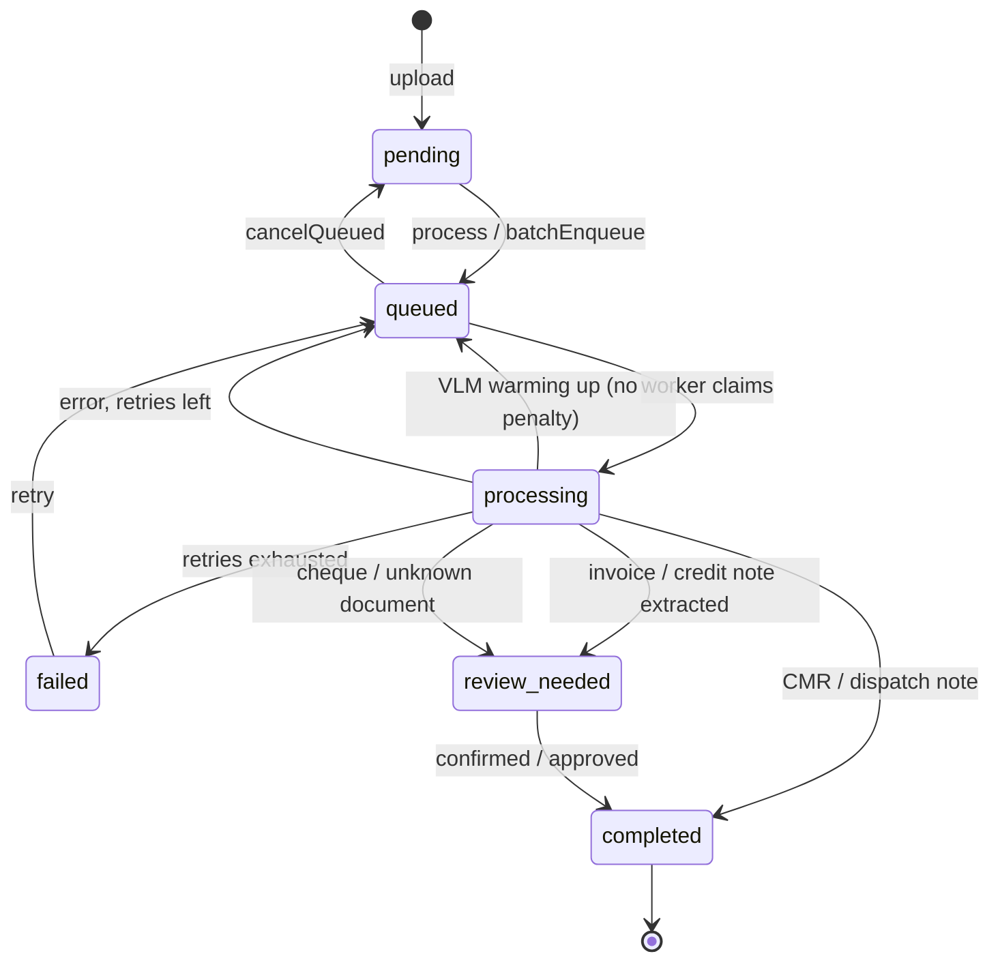
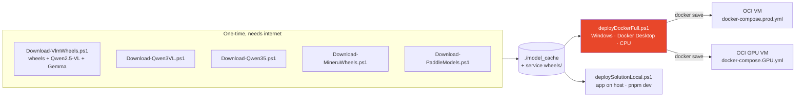

<div align="center">

# 🧾 OptimusInvoice

**AI invoice automation for Greek and international supplier documents.**
PDF in → OCR / vision models → validated invoice JSON → product matching with rule learning → approval → ERP.


*Optimus Research · George Georgakakos*

</div>

<p align="center">
  
</p>

---

## Contents

| | | |
|---|---|---|
| [1. What it does](#1-what-it-does) | [7. Processing lifecycle](#7-processing-lifecycle) | [13. Deployment](#13-deployment) |
| [2. What's changed](#2-whats-changed) | [8. Product matching & rule learning](#8-product-matching--rule-learning) | [14. Configuration](#14-configuration) |
| [3. Documentation map](#3-documentation-map) | [9. Multi-client profiles & ΓΕΜΗ](#9-multi-client-profiles--γεμη-lookup) | [15. Operations & health](#15-operations--health) |
| [4. Architecture](#4-architecture) | [10. User interface](#10-user-interface) | [16. Known issues & tech debt](#16-known-issues--tech-debt) |
| [5. Extraction engines](#5-extraction-engines) | [11. API reference](#11-api-reference-trpc) | [17. Roadmap](#17-roadmap) |
| [6. How a PDF becomes JSON](#6-how-a-pdf-becomes-json) | [12. Repository layout](#12-repository-layout) | [18. Keeping this README current](#18-keeping-this-readme-current) |

---

## 1. What it does

OptimusInvoice removes manual data entry for supplier invoices going into an ERP (SoftOne today).

* **Reads anything.** Digital PDFs are read from their text layer in under a second. Scanned documents go through **MinerU**, **Surya OCR** or **PaddleOCR PP-StructureV3**. Hard layouts can be sent to one of four local **vision-language models** (Qwen2.5-VL, Gemma 3, Qwen3-VL, Qwen3.5).
* **Understands Greek invoices.** myDATA / ΑΑΔΕ headers (MARK, UID, authentication code, provider), ΑΦΜ / ΔΟΥ / ΓΕΜΗ, Greek number formats (`1.234,56`), the combined *Τιμολόγιο Πώλησης – Δελτίο Αποστολής*, credit notes, CMRs and dispatch notes.
* **Checks its own work.** The invoice's arithmetic (qty × price, Σ lines, VAT, totals) is used to repair, validate and score every extraction. Vision results are flagged for review and never silently "fixed".
* **Learns supplier codes.** A four-algorithm matcher maps supplier product codes to ERP codes. After about 3 corrections per pattern it learns a transformation rule, so matching becomes mostly automatic.
* **Runs offline on a CPU box.** All models are pre-downloaded into `./model_cache`, and every model stack lives in its own container. A GPU compose file is available for OCI A10 VMs.
* **Survives real life.** A MySQL-backed queue means uploads return instantly, work continues after the browser closes, and invoices are deferred (not failed) while models warm up after a restart.

---

## 2. What's changed

> The lean source snapshot has no git history. This changelog is rebuilt from the dated snapshots kept in the repo (`vlm-service/Dockerfile_28032026`, `vlm-service/Dockerfile_22062026`, `docker-compose_23062026.yml`, `docker-compose_18072026.yml`), from the dates inside the docs, and from code compared against the previous README (which still described the pdfplumber-only v2.0 of early 2026).



### 2.1 Extraction stack: from one script to nine containers

| Area | Before (previous README) | Now |
|---|---|---|
| Text PDFs | `invoice_extractor_advanced.py` via pdfplumber, spawned per request | **pdfplumber pre-flight inside `vlm-service`** (≈0.1 s). NUL/control chars are stripped at the source because they used to crash `spawn()` in matching |
| Scanned PDFs | Tesseract.js (WASM) in Node | **MinerU sidecar** is picked automatically when healthy. **Surya 0.6.13** is the fallback. **PaddleOCR PP-StructureV3** can be selected explicitly |
| Understanding | Regex per layout | **Qwen2.5-3B Q4_K_M semantic LLM** (llama-cpp, temp 0, `n_ctx` 4096). It waits up to **180 s** for the model on first boot instead of 30 s, because the regex fallback produced wrong line items |
| Vision engines | none (roadmap item) | **qwen_vl_local** (Qwen2.5-VL-3B), **gemma_vl_local** (Gemma 3 4B GGUF), **qwen3vl_local** (Qwen3-VL-8B, llama-server b6907), **qwen35_local** (Qwen3.5-4B, llama-server b9828, reasoning off) |
| Isolation | single Python env | One container per conflicting stack: Surya needs `transformers==4.46.3`, Qwen-VL 5.4.0, MinerU torch 2.7 + transformers 4.57, Paddle 3.x, Qwen3.5 a newer llama.cpp |
| Vision safety | n/a | `vision_postprocess.py` (number, VAT and currency repair against pdfplumber reference text) and `vision_validator.py` (**flag, never fix**, `needs_review`) |
| Escalation | n/a | Low-confidence → Qwen-VL escalation exists but is **off by default** (`VLM_ESCALATION=0`): on CPU it can cost 30+ min per invoice |

### 2.2 Accuracy & domain logic

| Module | What it adds |
|---|---|
| `client_profile.py` + `data/client_profiles/*.json` | Replaces the hard-coded Ferryscanner identity with a per-tenant profile (e.g. `metro.json`), so the parser knows **who the recipient is** and never mistakes it for the issuer. The file is hot-reloaded on mtime change |
| `mydata_fields.py` | MARK, UID, authentication code and e-invoicing provider across Epsilon Net, IMPACT, SoftOne, Entersoft and Galaxy label variants (METRO PoC §4) |
| `dispatch_fields.py` | Dispatch date, vehicle number and purpose for combined ΤΔΑ documents that classify as `invoice` |
| `document_classifier.py` | Adds `cheque` / `unknown`, so bank cheques are no longer forced into invoice fields (e.g. an IBAN read as a total) |
| `arithmetic_validator.py` · `geometric_columns.py` · `ensemble_extractor.py` · `vlm_constrained.py` | The **ensemble** replaces the old waterfall. Geometric (right-aligned, centre-x) column reconstruction, constrained-schema VLM and the legacy parser compete, and the invoice's own arithmetic picks the winner. Wired into the legacy `invoice_extractor_advanced.py` path. See [Line-item geometry](docs/OptimusInvoice_LineItemExtractionGeometry.md) |
| `supplier_layout_profiles.py` | Per-supplier column x-positions, unit normalisation to myDATA units (ΤΕΜΑΧΙΟ, ΚΙΛΟ, ΛΙΤΡΟ…), success stats |
| `semantic_extractor._normalize_number` | Multi-unit quantity fix (`1.437` vs `1,437`), VAT hallucination guard, totals reconciliation |

### 2.3 Processing, data & UI

| Area | What's new |
|---|---|
| **Persistent queue** | `invoices.process` now only *enqueues*. `queueWorker.ts` claims jobs with `FOR UPDATE SKIP LOCKED`, retries up to 3×, recovers orphaned `processing` rows on boot, and **defers without penalty** while the VLM is warming up (`VLM_NOT_READY`) |
| **`invoiceProcessor.ts`** | Extraction logic moved out of the 1,500-line router into a reusable pipeline. It writes live progress strings and records which engine ran |
| **Extraction archive** | `extractionExporter.ts` writes every finalised extraction atomically to `extractions/<date>/<client>/<invoice>_<HHmmss>.json` (path-traversal safe). It has its own page and API |
| **Client profile page** | `/settings/client-profile`: edit the active tenant profile, or draft one from **ΓΕΜΗ Open Data** by ΑΦΜ |
| **Queue page** | `/queue`: live status, retry, cancel, batch enqueue |
| **Invoice list** | Filter bar, bulk selection, bulk process / approve / delete |
| **Approvals** | Submit / decide / history, **duplicate auto-reject**, export of approved invoices |
| **Configuration** | 8 selectable engines plus 4 shown as disabled, a live VLM status grid with preload buttons, a native-text toggle, ML thresholds, and ERP connector forms (SoftOne live; SAP B1, Dynamics and Custom are forms only) |
| **UX** | Command palette (⌘/Ctrl-K), keyboard shortcuts + help, branded empty states, CSV / XLSX export, processing timeline, a marketing-style landing page (`/`) |

### 2.4 Operations & deployment

| Script / file | Purpose |
|---|---|
| `deployDockerFull.ps1` | **Main deploy path.** Stages every service's Python from `server/python/` with SHA-verified copies, builds, runs smoke tests and probes health (now includes paddle-ocr) |
| `deploySolutionLocal.ps1` | Local dev deploy: pnpm, MySQL, `.env`, migrations, VLM containers, then the app on the host |
| `docker-compose.prod.yml` | OCI VM: pre-loaded images (`docker load`), only `:3000` exposed, DB and models internal |
| `docker-compose.GPU.yml` | OCI GPU VM (e.g. VM.GPU.A10.1): CUDA llama.cpp images, `--n-gpu-layers`, NVIDIA device reservations |
| `Download-Qwen3VL.ps1` · `Download-Qwen35.ps1` · `Download-PaddleModels.ps1` · `Download-MineruWheels.ps1` · `Download-VlmWheels.ps1` | One-shot, offline-first pre-downloads of weights, wheels and pinned images |
| `Show-OptimusConfig.ps1` | Dumps `.env` (secrets masked), DB `settingsJson` and container health |
| `compress-optimusInvoice-lean.ps1` · `git_OptimusInvoice.ps1` | Source-only ZIP (no `.git`, wheels or weights) and the GitHub upload helper |
| `vLMBenchmark/` | Ollama-based kit to score candidate VLMs against your own invoices before integrating them |

### 2.5 What this README fixes

The previous README described pdfplumber + scikit-learn only, two containers at most, `pnpm` on the host, a "batch queue" that was still on the roadmap, and an OAuth redirect loop as the top issue. It had no engine table, no queue, no sidecars, no client profiles and no links to the 13 other documents in the repo. Everything below reflects the code in this snapshot.

---

## 3. Documentation map

Start here, then go deeper in the specialised docs. *Status* says how far each one matches the current code.



| Document | What it covers | Status |
|---|---|---|
| [`architecture.md`](architecture.md) | Engine → container routing, proxy URLs per deploy path, why Qwen / Gemma are separate, CPU timings | 🟡 Covers surya, got_ocr2, semantic, qwen_vl_local, gemma. Missing qwen3vl, qwen35, mineru, paddle |
| [`docs/OptimusInvoiceVLMAIExtractionStack.md`](docs/OptimusInvoiceVLMAIExtractionStack.md) | Container topology, routing, models & versions, engine selection, native-text switch, tuning, deploy (Mermaid) | 🟡 Jun 2026, 5-container era. Lists Gemma as broken |
| [`docs/MODEL_VERSIONS.md`](docs/MODEL_VERSIONS.md) | Exact library versions read from running containers, and **why** each model was chosen | 🟡 Verified 2026-06-20. Needs Qwen3-VL, Qwen3.5, MinerU, Paddle rows |
| [`docs/GEMMA_BACKENDS.md`](docs/GEMMA_BACKENDS.md) | transformers bf16 vs llama.cpp Q4_K_M for Gemma 3: ≈15× faster, 2.4× less RAM | 🟢 Current |
| [`docs/WHY_LLAMA_CPP.md`](docs/WHY_LLAMA_CPP.md) | Why GGUF/llama.cpp is the production backend on CPU (memory bandwidth, K-quants, SIMD) | 🟢 Current. The same rationale drives Qwen3-VL and Qwen3.5 |
| [`docs/VLM_ARCHITECTURE.md`](docs/VLM_ARCHITECTURE.md) | The original 2-container split (Surya vs Qwen2.5-VL) | 🔴 Historical. Still carries old branding |
| [`docs/OptimusInvoice_docHandling.md`](docs/OptimusInvoice_docHandling.md) | Code-level trace of the text path: pdfplumber / Surya → semantic LLM → regex fallback → Node assembly | 🟡 Accurate for Path A. Predates MinerU, Paddle and the 180 s wait |
| [`docs/BACKEND_PIPELINE.md`](docs/BACKEND_PIPELINE.md) | Upload vs process phases, Python script reference, doc-type branches, auto-accept | 🟡 Mar 2026. Describes inline processing (now queued) |
| [`docs/OptimusInvoice_LineItemExtractionGeometry.md`](docs/OptimusInvoice_LineItemExtractionGeometry.md) | Geometric columns, constrained VLM, arithmetic validator, ensemble | 🟢 Current |
| [`docs/OptimusInvoice_TechnicalDoc.md`](docs/OptimusInvoice_TechnicalDoc.md) | File-by-file reference, DB schema, tRPC routers, SoftOne & OptimusDB integration | 🟡 v2.0 Mar 2026. Good for schema and ERP. Pre-queue and pre-sidecar |
| [`docs/BUILD_OUTPUT.md`](docs/BUILD_OUTPUT.md) | Web vs Electron builds, `dist/`, `dist-client/`, `dist-server/`, `dist-electron/` | 🟢 Current |
| [`BACKEND_FEATURE_SPECS.md`](BACKEND_FEATURE_SPECS.md) | Specs for RBAC roles, immutable audit log, duplicate/fraud detection, FX | 🟢 Roadmap |
| [`vLMBenchmark/README.md`](vLMBenchmark/README.md) | Benchmark VLMs on your invoices via Ollama, with ground-truth scoring | 🟢 Standalone tool |
| [`vlm-service/CommandHowTo.txt`](vlm-service/CommandHowTo.txt) | Raw build / run / test commands for the VLM image | 🔴 Pre-compose |
| [`docs/README_optimusInvoice.docx`](docs/README_optimusInvoice.docx) | Word export of the v2.0 technical documentation | 🔴 Mar 2026 |

**Figures** live in [`docs/figures/`](docs/figures). This README uses the two new figures (`readme_architecture.svg`, `readme_extraction_paths.svg`). The older figures (`architecture.png`, `pipeline_flow.svg`, `python_scripts.svg`, `optimus_deployment_map.svg`, `optimusinvoice_document_handling_map.svg`, `ERFlow_InvoiceAutomation*.mmd/png`) show the Mar–Jun 2026 design and are still referenced by the docs above.

---

## 4. Architecture

### 4.1 Containers

All services join the external Docker network **`optimus_ai_net`**. Model weights are bind-mounted from **`./model_cache`** and run offline (`HF_HUB_OFFLINE=1`).

| Service | Container | Port (host → internal) | Role | Model / runtime | In compose |
|---|---|---|---|---|---|
| `app` | `optimus-app` | 3000 → 3000 | React UI, tRPC API, queue worker, Python ML matcher | Node 22 · Express 4 · tRPC 11 | local · prod · GPU |
| `mysql` | `optimus-mysql` | 3306 → 3306 | Data store **and** job queue | MySQL 8.0 · Drizzle | local · prod · GPU |
| `vlm` | `vlm-service` | **8300 → 8100** | Dispatcher, pdfplumber, Surya, semantic LLM, regex, validators | Surya 0.6.13 · transformers 4.46.3 · llama-cpp-python 0.3.16 · Qwen2.5-3B-Instruct Q4_K_M | local · prod · GPU |
| `qwen-vl` | `optimus_qwen_vl` | 8400 | Vision → JSON | Qwen2.5-VL-3B-Instruct · transformers 5.4 · fp32 CPU | local only |
| `gemma-vl` | `optimus_gemma_vl` | 8500 | Vision → JSON | gemma-3-4b-it Q4_K_M + mmproj f16 · llama-cpp-python | local · prod · GPU |
| `qwen3vl` | `optimus_qwen3vl` | 8600 | Vision → JSON | Qwen3-VL-8B-Instruct Q4_K_M + mmproj F16 · `llama.cpp:server-b6907` | local · prod · GPU |
| `qwen35` | `optimus_qwen35` | 8800 | Vision → JSON, **and** the KIE LLM for Paddle | Qwen3.5-4B Q4_K_M + mmproj F16 · `llama.cpp:server-b9828` · reasoning off | local · prod · GPU |
| `mineru-service` | `optimus_mineru` | 8700 | Reader: PDF → Markdown (tables as HTML) | MinerU `pipeline` backend, CPU · torch 2.7 · transformers 4.57 | local · prod · GPU |
| `paddle-ocr` | `optimus_paddle_ocr` | 8900 | Reader (Path A), or reader + KIE (Path B) | PP-StructureV3 · `el_PP-OCRv5_mobile_rec` · PP-DocLayout-S | **local only** |

> **Why so many containers?** These stacks pin mutually incompatible versions of `transformers` (4.46.3 vs 4.57 vs 5.4), torch and llama.cpp. Qwen3.5 needs a newer llama.cpp than Qwen3-VL's pinned build. Every new model therefore gets **a new sidecar with the same HTTP contract** (`GET /health`, `POST /extract-pdf`), never a change to `vlm-service`'s environment.

### 4.2 Hardware baseline

CPU-only reference box: **12 cores / 64 GB RAM**, no GPU. Each heavy model runs single-stream (`--parallel 1`, `WORKER_CONCURRENCY=1`), because one invoice already saturates the cores. A GPU raises throughput; see `docker-compose.GPU.yml` (Qwen3.5-4B ≈ 4–6 GB VRAM, Qwen3-VL-8B ≈ 8–10 GB).

---

## 5. Extraction engines

Selected under **Configuration → VLM / AI Extraction Engines**. The choice is stored per user in `settingsJson.vlmEngine`, and `VLM_ENGINE` is only the default.

| Engine key | Path | What runs | Best for | Status |
|---|---|---|---|---|
| `auto` / `surya` | A | pdfplumber → *(scanned)* MinerU if healthy, else Surya → semantic LLM | **Default.** Digital PDFs are instant and exact | ✅ |
| `mineru` | A | MinerU Markdown → semantic LLM (Surya fallback) | Scanned docs, complex tables, no hallucination | ✅ |
| `paddle_ocr` | A or B | PP-StructureV3 Markdown → semantic LLM (KIE off, the compose default). With `PADDLE_KIE_BACKEND=llama_server` it emits JSON via qwen35 | Table-heavy Greek invoices | ✅ new |
| `qwen35_local` | B | Qwen3.5-4B vision via llama-server | Hard layouts. ≈ half the latency of the 8B | ✅ new |
| `qwen3vl_local` | B | Qwen3-VL-8B vision via llama-server | Hardest layouts, stamps, overlaps | ✅ |
| `gemma_vl_local` | B | Gemma 3 4B-it GGUF via llama-cpp-python | Second, independent vision opinion | ⚠️ last documented as "0 chars" (Jun 2026). Re-verify |
| `qwen_vl_local` | B | Qwen2.5-VL-3B transformers fp32 | Reference vision model. Slow (≈0.7 tok/s) | ✅ (local compose only) |
| `got_ocr2` · `marker` · `olmocr` · `qwen_vl` | – | – | – | ❌ disabled in UI: dependency conflicts or need vLLM + GPU |

**Path A = read, then understand.** A reader produces text or Markdown, and the in-container semantic LLM maps it to the invoice schema with the full text-path validation.
**Path B = see and answer.** A vision model returns invoice JSON directly. It is then post-processed and validated, with problems flagged rather than overwritten.

---

## 6. How a PDF becomes JSON

<p align="center">
  
</p>



On the Node side, `python-integration.ts → classifyAndExtract()` checks the VLM health endpoint (and throws a `VlmNotReadyError` during warm-up). It sends the multipart PDF to `/extract-pdf` with `extract_invoice=1`, classifies the document type, and assembles the extraction object along with its audit trail (`_vlm_engine`, `_vlm_extraction_method`, `_vlm_raw_text`, `_vlm_structured`).

**Confidence.** The regex path starts at 40 and adds up to 100 from found fields. The semantic path starts at 80 and adds items, total and parties. Vision validation lowers confidence when the numbers don't reconcile.

---

## 7. Processing lifecycle





**Document-type branches** (in `invoiceProcessor.ts`):

| Type | Line items | ML matching | Stored as | Final status |
|---|---|---|---|---|
| `invoice`, `credit_note` | ✅ | ✅ per line, auto-accept ≥ `autoAcceptThreshold` (default **90**) | `invoiceLineItems` + `extractedDataJson` | `review_needed` |
| `dispatch_note` | goods list | – | JSON fields | `completed` |
| `cmr` | – | – | sender / carrier / consignee / goods JSON | `completed` |
| `cheque`, `unknown` | – | – | reason in `extractedDataJson` | `review_needed` |

---

## 8. Product matching & rule learning

`ml_product_matcher_v2.py` runs once per line item, called as a Python child process from the app:

| Priority | Algorithm | Confidence |
|---|---|---|
| 1 | Exact code in the knowledge base | 100 |
| 2 | Learned transformation rule for this supplier | 75–95 |
| 3 | Fuzzy code similarity (`difflib`) | 40–74 |
| 4 | Description similarity | 20–60 |

`rule_learning_engine.py` watches corrections (`products.confirmMatch`) and creates a rule after **3 confirmations** of the same pattern: `prefix_addition`, `prefix_removal`, `suffix_addition`, `suffix_removal`, `separator_removal`, `character_replacement` or `regex_pattern`.

| Invoice | Supplier code | User picks | System |
|---|---|---|---|
| #1 | `74245` | `317-74245` | records |
| #2 | `74810` | `317-74810` | records |
| #3 | `75001` | `317-75001` | ✅ rule: add prefix `317-` |
| #4+ | any | – | applied automatically |

Rules and mappings can be edited in **Knowledge Base** and **Rule Learning**. ERP catalogue import and auto-mapping live under **ERP Data Model**.

---

## 9. Multi-client profiles & ΓΕΜΗ lookup

Each deployment serves **one receiving client** (the operator, e.g. METRO or Ferryscanner). The profile tells the parsers what *that* client looks like, so its name and address are never extracted as the supplier.

```json
{
  "clientName": "METRO AEBE",
  "clientVats": ["EL094325446"],
  "clientNamePatterns": ["METRO\\s*AEBE", "ΜΕΤΡΟ\\s*ΑΕΒΕ"],
  "clientAddressPatterns": ["Σώρου\\s+\\d+"],
  "skipIssuerPatterns": ["METRO", "ΜΕΤΡΟ"],
  "managerPatterns": []
}
```

* **Location:** `OPTIMUS_CLIENT_PROFILE_PATH`, then `OPTIMUS_CLIENT_PROFILE` (compose: `/app/data/client_profiles/metro.json`), then `data/client_profiles/active.json`. The folder is bind-mounted into both `app` and `vlm`.
* **Hot reload:** `client_profile.py` watches the file's mtime, so a save from the UI applies to the next invoice without a restart.
* **ΓΕΜΗ:** `clientProfile.lookupByVat` calls the Business Portal Open Data API (`BUSINESS_PORTAL_API_KEY`) to draft a profile from an ΑΦΜ in about a minute.
* **No profile loaded** = fully generic extraction. This is deliberately safer than a wrong tenant's hard-coded defaults.

---

## 10. User interface

| Route | Page | Highlights |
|---|---|---|
| `/` | Home | Landing page |
| `/dashboard` | Dashboard | Automation rate, analytics, pending approvals, KB stats |
| `/invoices/upload` | Upload | Drag-and-drop multi-file, live queue status per file |
| `/queue` | Processing Queue | Live progress, engine used, retry / cancel |
| `/invoices` | Invoice List | Filters, bulk select → process / approve / delete, export |
| `/invoices/:id` | Invoice Detail | Side-by-side PDF, extraction-method badge, line items, match / search / confirm, push to ERP / OptimusDB, debug panel |
| `/approvals` | Approvals | Pending queue, decide, history, duplicate auto-reject |
| `/extractions` | Extractions | Browse / view / delete archived JSON by date and client |
| `/knowledge-base` | Knowledge Base | Mappings, rules, suppliers, CSV import |
| `/rules` | Rule Learning | Learned rules, edit / delete, stats |
| `/erp-model` | ERP Data Model | Product catalogue, categories, import, auto-map, unmapped |
| `/configuration` | Configuration | ERP connector, engine choice + VLM status grid + preload, native text, ML thresholds, OptimusDB |
| `/settings/client-profile` | Client Profile | Tenant profile editor + ΓΕΜΗ lookup |

Global features: ⌘/Ctrl-K command palette, keyboard shortcuts (`?` for help), light/dark theme, and the Electron desktop wrapper.

---

## 11. API reference (tRPC)

All endpoints are tRPC procedures under `/api/trpc`. Types flow end-to-end, so TypeScript autocomplete is the source of truth. Apart from `system` and `auth`, every procedure is `protectedProcedure`.

<details>
<summary><b>15 routers · ~100 procedures</b> (click to expand)</summary>

| Router | Procedures |
|---|---|
| `system` | `health`, `notifyOwner` (admin) |
| `auth` | `me`, `logout` |
| `invoices` | `list`, `getById`, `delete`, `getPdf`, `upload`, `process` (enqueue), `batchEnqueue`, `queueStatus`, `retry`, `cancelQueued`, `statistics`, `analytics`, `exportHistory`, `exportById` |
| `extractions` | `list`, `get`, `delete`, `reexport` |
| `products` | `search`, `match`, `confirmMatch` |
| `rules` | `list`, `bySupplier`, `statistics` |
| `knowledgeBase` | `mappings`, `updateMapping`, `deleteMapping`, `rules`, `deleteRule`, `updateRule`, `suppliers`, `stats`, `importMappings` |
| `erpModel` | `products`, `categories`, `stats`, `mappingCounts`, `unmapped`, `upsertProduct`, `deleteProduct`, `importProducts`, `autoMap`, `allMappings`, `addMapping`, `updateMapping`, `deleteMapping`, `exportProducts`, `suppliers` |
| `softone` | `testConnection`, `getProducts`, `findProduct`, `getSuppliers`, `findSupplier`, `createInvoice` |
| `approvals` | `pending`, `byInvoice`, `submit`, `decide`, `history`, `exportApproved`, `pendingCount`, `autoRejectDuplicate` |
| `notifications` | `list`, `unreadCount`, `markRead`, `markAllRead` |
| `configuration` | `get`, `getSettings`, `saveSettings`, `save`, `testConnection` |
| `optimusDb` | `testConnection`, `pushInvoice`, `pushAll` |
| `clientProfile` | `get`, `upsert`, `lookupByVat` |
| `vlm` | `status`, `preload` |

</details>

**VLM service HTTP (`vlm-service :8100`)**: `GET /health`, `POST /extract-pdf` (multipart: `file`, `engine`, `extract_invoice`, `use_native_text`), `POST /ocr`, `POST /ocr/pipeline`, `POST /chat/vision`, `POST /convert/pdf[/upload]`, `GET /models`, `POST /preload/{engine}`.
**Sidecars** expose `GET /health` and `POST /extract-pdf`. The llama-server sidecars expose the OpenAI-compatible `/v1/chat/completions`.

### Data model

Tables (Drizzle, `drizzle/schema.ts`): `users`, `invoices` (now also the queue: `status`, `engine`, `progress`, `retryCount`, `queuedAt`…), `invoiceLineItems`, `suppliers`, `products`, `productMappings`, `transformationRules`, `configuration` (`settingsJson`), `notifications`, `approvals`. The full column reference is in [Technical doc §6](docs/OptimusInvoice_TechnicalDoc.md#6-database-schema). `Dockerfile.app` runs `pnpm db:push` on boot.

---

## 12. Repository layout

```text
optimusInvoice/
├── client/src/
│   ├── pages/                 13 routed pages (see §10) + ComponentShowcase
│   ├── components/            DashboardLayout, CommandPalette, ProcessingTimeline, ui/ (shadcn)
│   └── lib/                   trpc, csvExport, exportInvoices
├── server/
│   ├── _core/                 Express bootstrap, tRPC, OAuth, env, LLM / voice / map helpers
│   ├── routers.ts             appRouter (13 inline routers) + clientProfileRouter + vlmRouter
│   ├── invoiceProcessor.ts    ★ shared extraction pipeline (called by the worker)
│   ├── queueWorker.ts         ★ persistent background queue
│   ├── python-integration.ts  Node ↔ vlm-service bridge, doc-type detection
│   ├── extractionExporter.ts  ★ atomic JSON archive
│   ├── clientProfileRouter.ts ★ profile get/upsert/ΓΕΜΗ lookup
│   ├── businessPortalClient.ts★ ΓΕΜΗ Open Data client
│   ├── vlmRouter.ts           engine status grid + preload
│   ├── invoiceDb.ts · db.ts   Drizzle queries
│   ├── softoneClient.ts       SoftOne ERP client
│   ├── optimusDbClient.ts     OptimusDB catalogue push
│   └── python/                ★ SOURCE OF TRUTH for every service's Python
│       ├── vlm_service.py              → copied to vlm-service/app.py
│       ├── semantic_extractor.py · vlm_invoice_parser.py · vision_validator.py · vision_postprocess.py
│       ├── client_profile.py · mydata_fields.py · dispatch_fields.py
│       ├── qwen_vl_* · gemma_vl_* · qwen3vl_engine.py · qwen35_engine.py
│       ├── mineru_* · paddle_ocr_* · paddle_kie.py · paddle_ppchatocr.py
│       ├── ensemble_extractor.py · geometric_columns.py · arithmetic_validator.py · supplier_layout_profiles.py
│       ├── invoice_extractor_advanced.py · document_classifier.py · credit_note/cmr/dispatch_extractor.py
│       └── ml_product_matcher_v2.py · rule_learning_engine.py · softone_api_client.py
├── vlm-service/  gemma-vl-service/  mineru-service/  paddle-ocr-service/   build contexts (Dockerfile + staged .py)
├── Dockerfile.app · Dockerfile.qwen_vl · Dockerfile.gemma_vl · Dockerfile.mineru · Dockerfile.vlm (CUDA)
├── docker-compose.yml · docker-compose.prod.yml · docker-compose.GPU.yml   (+ dated snapshots)
├── data/client_profiles/      metro.json (bind-mounted)
├── docs/                      specialised docs + figures/
├── electron/                  main.js, preload.js
├── vLMBenchmark/              VLM benchmark kit
└── *.ps1                      deploy, download, config-dump, packaging scripts
```

> **Sync rule.** Edit Python only in `server/python/`. The deploy scripts copy it (SHA-verified) into each service folder before `docker build`. `qwen-vl-service/` is generated at deploy time and git-ignored.

---

## 13. Deployment



### Prerequisites

| | Version | Notes |
|---|---|---|
| Docker Desktop / Engine | recent | Create the network once: `docker network create optimus_ai_net` |
| Node.js + pnpm | 22 · 10.x | Only for host-side development |
| Python | 3.11 | For the download scripts (`huggingface_hub`) |
| Disk | ~40 GB | Weights for all vision models + wheels + images |
| RAM | 64 GB recommended | Container caps total well above 32 GB if all sidecars run |
| `HF_TOKEN` | – | Gemma 3 is gated, so accept its license on Hugging Face first |

### Full stack (recommended)

```powershell
# 1. one-time downloads (internet)
.\Download-VlmWheels.ps1
.\Download-Qwen3VL.ps1
.\Download-Qwen35.ps1
.\Download-MineruWheels.ps1
docker compose build paddle-ocr ; .\Download-PaddleModels.ps1

# 2. configure
copy .env.example .env      # set JWT_SECRET, HF_TOKEN, BUSINESS_PORTAL_API_KEY

# 3. deploy (stages server/python → service folders, builds, smoke-tests)
.\deployDockerFull.ps1

# 4. open http://localhost:3000 → Configuration → pick engine → upload
```

First cold start: `vlm` ≈ 8 min (Surya + semantic model load; healthcheck `start_period` is 900 s), vision sidecars 4–11 min. The worker defers invoices until `vlm` reports healthy.

### Development (app on host)

```powershell
.\deploySolutionLocal.ps1   # MySQL + VLM in Docker, migrations, then:
pnpm dev                    # http://localhost:3000  (VLM_SERVICE_URL=http://localhost:8300)
pnpm check                  # TypeScript
pnpm test                   # vitest
```

### OCI / GPU

Build locally, then `docker save` the images (`optimus-app`, `vlm-service`, `gemma-vl-service`, `mineru-service`) and `docker load` them on the VM. Copy `.env`, `model_cache/` and `data/client_profiles/` across, then run `docker compose -f docker-compose.prod.yml up -d` (or `docker-compose.GPU.yml` on an NVIDIA host with nvidia-container-toolkit). Only port **3000** is published.

### Desktop app

`pnpm electron:build:win` (or `:mac`, `:linux`) writes to `dist-electron/`. See [BUILD_OUTPUT.md](docs/BUILD_OUTPUT.md).

---

## 14. Configuration

<details>
<summary><b>App &amp; worker</b> (<code>optimus-app</code>)</summary>

| Variable | Default | Purpose |
|---|---|---|
| `DATABASE_URL` | – | `mysql://…@mysql:3306/invoice_automation` |
| `JWT_SECRET` | – | 64-byte hex session secret |
| `VLM_SERVICE_URL` | `http://localhost:8100` (compose: `http://vlm:8100`) | Extraction dispatcher |
| `VLM_ENGINE` | `auto` | Default engine (the user's DB setting wins) |
| `VLM_TIMEOUT` | `600000` | ms per `/extract-pdf` call |
| `VLM_READY_TIMEOUT_MS` / `VLM_READY_POLL_MS` | `8000` / `4000` | Readiness pre-check budget |
| `WORKER_CONCURRENCY` | `1` | Parallel claim loops (raise only with a GPU) |
| `WORKER_IDLE_MS` | `2000` | Poll interval when the queue is empty |
| `WORKER_MAX_RETRIES` | `3` | Then → `failed` |
| `WORKER_RETRY_BACKOFF_MS` | `5000` | Between retries |
| `WORKER_VLM_WARMUP_BACKOFF_MS` | `30000` | Deferral while models load |
| `EXTRACTIONS_DIR` | `./extractions` | JSON archive root |
| `OPTIMUS_CLIENT_PROFILE[_PATH]` | `data/client_profiles/active.json` | Active tenant profile |
| `BUSINESS_PORTAL_API_KEY` / `_URL` | – | ΓΕΜΗ Open Data |
| `OAUTH_SERVER_URL`, `VITE_APP_ID`, `OWNER_OPEN_ID` | – | Auth |

</details>

<details>
<summary><b>vlm-service</b></summary>

| Variable | Compose value | Purpose |
|---|---|---|
| `SEMANTIC_ENABLED` / `SEMANTIC_MODEL` | `1` / `qwen2.5:3b` | Also: `qwen2.5:7b`, `phi3.5:mini`, `llama3.2:3b`, `mistral:7b` |
| `SEMANTIC_TIMEOUT` · `SEMANTIC_MAX_TOKENS` · `SEMANTIC_LOAD_WAIT` | `120` · `1024` · `180` | Inference limits / first-boot wait |
| `LLAMA_N_CTX` · `LLAMA_N_THREADS` · `LLAMA_N_BATCH` | `4096` · `10` · `512` | ≥ 4096 avoids truncated JSON |
| `SURYA_LANGS` · `MAX_PAGES` | `el,en` · `10` | OCR languages, page cap |
| `VLM_ESCALATION` | `0` | Qwen-VL rescue of low-confidence text extractions |
| `QWEN_VL_` · `GEMMA_VL_` · `QWEN3VL_` · `QWEN35_` · `MINERU_` · `PADDLE_OCR_SERVICE_URL` | compose hostnames | Sidecar targets |
| `QWEN3VL_DPI` / `QWEN35_DPI` | `85` / `110` | Page raster resolution for vision |

</details>

<details>
<summary><b>Sidecars</b></summary>

| Service | Key settings |
|---|---|
| qwen-vl | `QWEN_VL_MAX_PIXELS=470400`, `QWEN_VL_DPI=96`, `QWEN_VL_DTYPE=fp32`, `QWEN_VL_LOCAL_MAX_TOKENS=448` |
| gemma-vl | explicit `GEMMA_VL_MODEL_PATH` / `GEMMA_VL_MMPROJ_PATH` snapshot paths, `LLAMA_N_BATCH=1024`, `GEMMA_MAX_NEW_TOKENS=512`, `GEMMA_VL_DPI=100`, `HF_TOKEN` |
| qwen3vl | `--ctx-size 4096 --threads 10 --parallel 1 --no-mmap --temp 0.2 -n 2048` (b6907 has the multimodal KV-cache fix) |
| qwen35 | `--threads 12 --temp 0.1 --reasoning off --no-mmap` on b9828 |
| mineru | `MINERU_BACKEND=pipeline`, `MINERU_DEVICE_MODE=cpu`, `MINERU_LANG=el` |
| paddle-ocr | `PADDLE_LANG=el`, `PADDLE_USE_TABLE=1`, `PADDLE_DPI=150`, `PADDLE_KIE_BACKEND=none\|llama_server\|ppchatocr`, `KIE_LLM_URL=http://qwen35:8800` |

</details>

ERP credentials, the engine choice, native-text, matching thresholds and OptimusDB settings are stored in the database through the **Configuration** page, not in `.env`.

---

## 15. Operations & health

| Service | Health |
|---|---|
| app | `http://localhost:3000` |
| vlm-service | `http://localhost:8300/health` (shows Surya `loaded`/`loading` and advertised engines) |
| qwen-vl · gemma-vl | `:8400/health` · `:8500/health` |
| qwen3vl · qwen35 | `:8600/health` · `:8800/health` |
| mineru · paddle-ocr | `:8700/health` · `:8900/health` |

```powershell
.\Show-OptimusConfig.ps1                  # .env (masked) + DB settings + health
docker compose logs -f vlm               # dispatcher, engine choice, timings
docker compose exec vlm pip show surya-ocr transformers llama-cpp-python
```

**Troubleshooting**

| Symptom | Likely cause → fix |
|---|---|
| Invoices sit in `queued` after a reboot | Models are reloading. This is expected for ~8 min, and the worker defers without counting retries |
| Wrong line items / €-amounts from the P.O. box | The regex fallback ran because the semantic model wasn't loaded. Check `[Semantic]` logs and raise `SEMANTIC_LOAD_WAIT` |
| Old behaviour after editing Python | Edit `server/python/`, redeploy (the scripts re-stage with SHA checks), and clear the `vlm-cache` volume if needed |
| Truncated JSON | Raise `LLAMA_N_CTX` (≥ 4096) or the engine's `*_MAX_TOKENS` |
| Engine choice "does nothing" | The DB setting overrides `VLM_ENGINE`. Check Configuration, or `Show-OptimusConfig.ps1` |

---

## 16. Known issues & tech debt

Found while reviewing this snapshot (2026-10-24). 🔴 = wrong behaviour, 🟡 = gap, ⚪ = housekeeping.

| # | Issue | Impact | Fix |
|---|---|---|---|
| 🔴 1 | `vlm-service/Dockerfile` does **not** `COPY vision_postprocess.py`, but `qwen3vl_engine.py` and `qwen35_engine.py` import it inside a `try` | Qwen3-VL and Qwen3.5 results **skip** number/VAT/currency post-processing silently (log: `postprocess skipped: No module named 'vision_postprocess'`) | Add `COPY vision_postprocess.py .` and stage it into `vlm-service/` in both deploy scripts |
| 🔴 2 | In `docker-compose.yml`, `mem_limit` sits **inside `environment:`** for vlm, qwen-vl, gemma-vl, mineru and paddle-ocr | Becomes an env var, so **no memory cap** is applied | Move to service level, as already done for qwen3vl / qwen35 and in prod/GPU |
| 🔴 3 | The lean ZIP includes `.env` with a live `HF_TOKEN` and `JWT_SECRET` | Secret leak if the ZIP is shared | Rotate the HF token, and exclude `.env` in `compress-optimusInvoice-lean.ps1` |
| 🟡 4 | `paddle_ocr` is missing from `ALL_ENGINES` in `vlmRouter.ts` | No status tile or preload button for Paddle | Add `paddle_ocr: { type: "local" }` |
| 🟡 5 | Paddle Path A ends with `extraction_method = "unknown"` | Wrong UI badge | Add `"markdown" if used_engine in ("mineru","paddle_ocr")` |
| 🟡 6 | `paddle-ocr` is not in `docker-compose.prod.yml` / `.GPU.yml` | Selecting it on OCI silently falls back to Surya | Add the service + image to the `docker save` list |
| 🟡 7 | `vision_validator`'s `_validation.issues` / `needs_review` are never read by Node or the UI | Vision warnings are invisible to reviewers | Surface them in `invoiceProcessor` (force `review_needed`) and in the InvoiceDetail debug panel |
| 🟡 8 | `gemma_vl_local` was last documented as returning 0 chars | Unclear whether it is usable | Re-test after the llama.cpp handler changes. Update MODEL_VERSIONS |
| ⚪ 9 | Dead code: `server/vlmOrchestrator.ts`, `server/ocr.ts`, `server/pythonBridge.ts`, `server/python/vlm_extractor.py`. Stale `vlm-service/qwen_vl_engine.py` (544 vs 623 lines in `server/python/`) | Confusion during maintenance | Delete or archive |
| ⚪ 10 | `ComponentShowcase.tsx` calls `trpc.ai.chat`, which doesn't exist | `pnpm check` noise (the page isn't routed) | Remove the page or the call |
| ⚪ 11 | Stray `--json` file (an `.xlsx`) at the repo root, from a mistyped CLI flag | Clutter | Delete |
| ⚪ 12 | Doc drift: the compose header lists 7 services (there are 9). The UI comments say Qwen3-VL **Q5**_K_M but compose loads **Q4**_K_M. Several docs predate the queue and sidecars (see §3) | Misleading docs | Update when touching each file |
| ⚪ 13 | `drizzle/` (schema + migrations) is excluded from the lean ZIP | Schema can't be reviewed from the snapshot | Include `drizzle/*.ts` in the lean package |

---

## 17. Roadmap

From [`BACKEND_FEATURE_SPECS.md`](BACKEND_FEATURE_SPECS.md) and the open items above:

- [ ] **RBAC roles**: `admin`, `approver`, `clerk`, `viewer` (the admin primitive already exists)
- [ ] **Immutable audit log** table for every approval, edit and ERP post
- [ ] **Duplicate / fraud detection** beyond approval auto-reject (supplier + number + amount fingerprint)
- [ ] **Multi-currency / FX** fields on invoices and lines
- [ ] **Confidence-driven review queue** using arithmetic and vision-validator scores
- [ ] Surface vision `needs_review` and issues in the UI (#7)
- [ ] Benchmark Qwen3.5-4B vs Qwen3-VL-8B vs Paddle-KIE on the ground-truth set (`vLMBenchmark/`) and refresh MODEL_VERSIONS
- [ ] Real connectors for SAP B1 / Dynamics (the config UI already exists)
- [ ] Email-inbox ingestion feeding the queue

---

## 18. Keeping this README current

When something changes, update the matching section:

| You changed… | Update |
|---|---|
| a service in `docker-compose*.yml` | §4.1 container table, the architecture SVG, the compose header comment |
| an engine (added / fixed / disabled) | §5 engine table, `vlmRouter.ts` `ALL_ENGINES`, Configuration options, [MODEL_VERSIONS](docs/MODEL_VERSIONS.md) |
| a tRPC procedure | §11 API table |
| a page / route | §10 UI table |
| env vars | §14 |
| a doc in `docs/` | §3 status column |

The figures in `docs/figures/readme_*.svg` are hand-written SVG (no build step) and open in any editor. Mermaid blocks render natively on GitHub.

---

<div align="center">
<sub>OptimusInvoice · Optimus Research by George Georgakakos · MIT License · snapshot 2026-10-24</sub>
</div>
