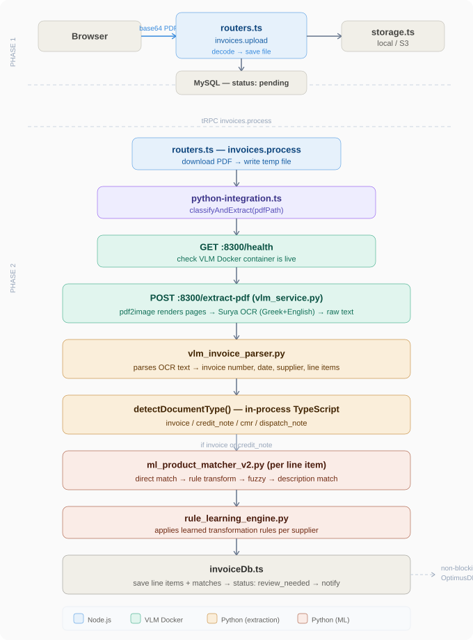
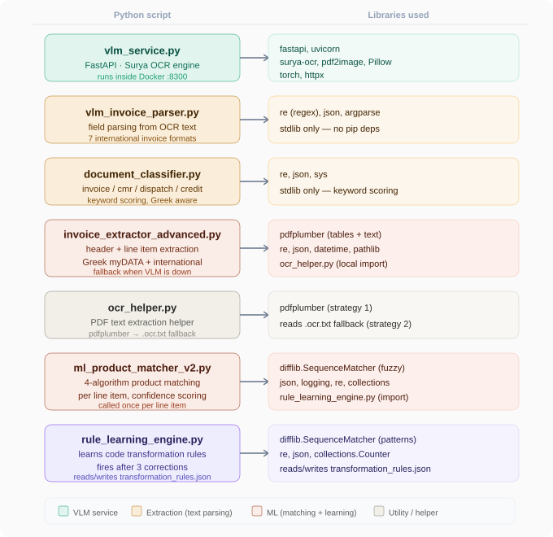

# 🔄 Invoice Processing — Backend Pipeline

> What happens on the backend when you upload an invoice, which Python scripts are invoked, and how the VLM service fits in.

---

## Overview

When you upload a PDF invoice, the backend executes two separate tRPC calls. The first is a simple file upload with no ML involved. The second is the full processing pipeline — OCR, extraction, classification, product matching, and rule learning.

| Phase | tRPC Procedure | Python called? | What happens |
|---|---|---|---|
| 1 — Upload | `invoices.upload` | No | base64 decode → save to storage → DB row (status: pending) |
| 2 — Process | `invoices.process` | Yes — 4+ scripts | OCR → extraction → classify → match → save line items |

---

## Figure 1 — Full Backend Flow

The diagram below shows both phases end-to-end, from browser upload through to the final database write and OptimusDB push.



---

## Phase 1 — Upload (`invoices.upload`)

No Python is called in this phase. The process is purely file handling:

1. The frontend base64-encodes the PDF and sends it over tRPC
2. `routers.ts` decodes the base64 buffer
3. `storage.ts` saves the file to local filesystem (dev) or S3/Forge (production) under key `invoices/{userId}/{timestamp}-{filename}.pdf`
4. `invoiceDb.ts` creates a database row in the `invoices` table with `status: "pending"`
5. The `invoiceId` is returned to the frontend

The invoice sits in the database as `pending` until the user (or the UI automatically) triggers the process step.

---

## Phase 2 — Process (`invoices.process`)

This is where everything happens. Triggered when "Process" is clicked. The full call sequence:

```
routers.ts (invoices.process)
    │
    ├─ 1. Fetch PDF from storage → write to OS temp file
    │
    ├─ 2. python-integration.ts → classifyAndExtract(tempPath)
    │       │
    │       ├─ A. GET :8300/health          ← check VLM Docker container
    │       ├─ B. POST :8300/extract-pdf    ← Surya OCR (vlm_service.py)
    │       ├─ C. vlm_invoice_parser.py     ← parse structured fields
    │       └─ D. detectDocumentType()      ← in-process keyword classifier
    │
    ├─ 3. updateInvoiceDocumentType()       ← save doc type to DB
    │
    ├─ 4. For each line item:
    │       ├─ createInvoiceLineItem()      ← save to DB
    │       ├─ ml_product_matcher_v2.py     ← find ERP code matches
    │       └─ rule_learning_engine.py      ← apply learned rules
    │
    ├─ 5. updateInvoiceStatus("review_needed")
    ├─ 6. createNotification()
    └─ 7. tryPushToOptimusDb()              ← non-blocking background push
```

> **Note:** If the VLM Docker container is not running, `classifyAndExtract()` throws immediately and the invoice is set to `failed`. There is no silent OCR fallback — the VLM service is required.

---

## The VLM Service — What It Does

The VLM service is a separate **Docker container** running a FastAPI app (`vlm_service.py`) on port 8300. It is the entry point for all OCR work.

### Default engine: Surya

When `classifyAndExtract()` is called, `python-integration.ts` sends the PDF to `POST :8300/extract-pdf`. The `auto` engine resolves to **Surya** by default.

Inside the container, for each page:

1. `pdf2image.convert_from_bytes()` renders the PDF page to a PNG image at 200 DPI
2. The PNG is base64-encoded and passed to `_run_surya()`
3. Surya runs **layout detection** (finds text regions, tables, figures) then **text recognition** within each region
4. Text from all pages is joined and returned as a single string

Surya is configured with `SURYA_LANGS=el,en` — Greek + English — which is why it handles both Greek myDATA invoices and international formats like Fiverr.

> **Why is the first invoice slow?** Surya loads its model weights lazily on the first call. Subsequent calls use the already-loaded model and are much faster.

### Available VLM engines

| Engine | Trigger | Speed | Best for |
|---|---|---|---|
| `surya` | Default (`auto` mode) | 10–30s | Greek + English, scanned docs |
| `got_ocr2` | `VLM_ENGINE=got_ocr2` in `.env` | 3–7 min | Complex tables, high accuracy |
| `olmocr` | `VLM_ENGINE=olmocr` + vLLM on port 8200 | 1–3 min | Structured JSON extraction |
| `marker` | `VLM_ENGINE=marker` | 30–90s | Mixed PDF (text + scan) |
| `qwen_vl` | `VLM_ENGINE=qwen_vl` + vLLM on port 8200 | 30–60s | Visual Q&A, custom prompts |

> `olmocr` and `qwen_vl` require the separate vLLM container which downloads ~7B parameter models and is not active by default.

### The `extract_invoice=1` optimisation

`python-integration.ts` passes `extract_invoice=1` to the VLM endpoint. The service then calls `vlm_invoice_parser.py` internally and returns a structured invoice dict under the `invoice` key — meaning you get both raw OCR text and structured field extraction in a **single HTTP call**.

---

## Figure 2 — Python Scripts and Their Libraries

The diagram below maps each Python script to the libraries it depends on.



---

## Python Scripts — Full Reference

### `vlm_service.py` — VLM Docker container

**Role:** FastAPI OCR microservice. Entry point for all document processing. Runs inside the Docker container on port 8300.

**Endpoints:**
- `GET /health` — returns loaded models and service status
- `POST /extract-pdf` — accepts a PDF, runs OCR, returns raw text + optional structured invoice object
- `POST /extract` — single-page image OCR

**Libraries:** `fastapi`, `uvicorn`, `surya-ocr`, `pdf2image`, `Pillow`, `torch`, `httpx`

---

### `vlm_invoice_parser.py` — Field parsing

**Role:** Parses raw OCR text into structured invoice fields. Handles multiple international invoice formats.

**Invoked by:** `vlm_service.py` (inside the Docker container) when `extract_invoice=1`, and also directly by `python-integration.ts` via `parseInvoiceWithVlmParser()` when the VLM returns only raw text.

**Supported formats:** Fiverr, Adobe, Travel Services LTD (dual-currency), Trengo, GitHub receipts, New Relic, Pharos GBP

**Libraries:** `re`, `json`, `argparse` — stdlib only, no pip dependencies

**Output:** JSON with `invoiceNumber`, `invoiceDate`, `supplier`, `lineItems[]`, `total`, `currency`, `confidence`

---

### `document_classifier.py` — Document type detection

**Role:** Classifies the document type from extracted text using keyword scoring.

**How it works:** Builds a score map for each type (`invoice`, `credit_note`, `cmr`, `dispatch_note`) by counting matching keywords. Highest score wins. Special handling for Greek combined documents — `Τιμολόγιο Πώλησης - Δελτίο Αποστολής` is always classified as `invoice`, not `dispatch_note`.

> In the VLM path, classification is done in-process by `detectDocumentType()` in `python-integration.ts`. `document_classifier.py` is the legacy standalone fallback.

**Libraries:** `re`, `json`, `sys` — stdlib only

---

### `invoice_extractor_advanced.py` — Full extraction (VLM fallback)

**Role:** Full invoice data extractor — header fields + line items — using `pdfplumber`. This is the **fallback path** used when the VLM service is not running.

**Extraction strategies (in order):**
1. `pdfplumber` table extraction (structured column mapping)
2. Header keyword detection → line item section scanning
3. International line format parser (`Description qty price total`)
4. Direct row detection (Greek product code prefix patterns)
5. Dispatch-note style patterns (Greek unit markers: `ΤΕΜΑΧ`, `ΤΕΜ`, etc.)

**Supports:** Greek myDATA/ΑΑΔΕ format, Greek number parsing (`1.234,56` → `1234.56`), international service invoices (Fiverr, Adobe, GitHub), month-name date formats (`Feb 19, 2026`)

**Libraries:** `pdfplumber`, `re`, `json`, `datetime`, `pathlib`, `sys`, `os`

**Imports locally:** `ocr_helper.py`

---

### `ocr_helper.py` — PDF text extraction helper

**Role:** PDF text extraction helper for the Python side of the pipeline. Used by `invoice_extractor_advanced.py`.

**Two strategies (in priority order):**
1. `pdfplumber` — always attempted first. Preserves Greek characters and table structure. Returns both plain text and structured table data.
2. Pre-extracted OCR text — reads a `.ocr.txt` file created by the Node.js `ocr.ts` pipeline (Tesseract WASM). Used as fallback when pdfplumber returns less than ~50 characters (scanned PDF).

**Libraries:** `pdfplumber`, `sys`, `os`

---

### `ml_product_matcher_v2.py` — Product matching

**Role:** Matches supplier product codes to ERP product codes using 4 algorithms in priority order. Called once per line item after extraction.

**Matching algorithms:**

| Priority | Algorithm | Confidence | Description |
|---|---|---|---|
| 1 | Direct exact match | 100 | Supplier code found verbatim in knowledge base |
| 2 | Rule-based transformation | 75–95 | Apply learned transformation rules per supplier |
| 3 | Fuzzy string matching | 40–74 | `difflib.SequenceMatcher` similarity ratio |
| 4 | Description matching | 20–60 | Compare product description text |

**Libraries:** `difflib`, `json`, `logging`, `re`, `collections`, `datetime`

**Imports locally:** `rule_learning_engine.py`

**Reads:** `knowledge_base.json`

---

### `rule_learning_engine.py` — Rule learning

**Role:** Automatically learns code transformation rules from user corrections. After 3 confirmations of the same pattern, a rule is auto-generated.

**Invoked by:**
- `ml_product_matcher_v2.py` (imported directly) — applies existing rules during matching
- `python-integration.ts` via `learnFromCorrection()` — called when a user manually corrects a match in the UI

**Rule types learned:**

| Rule type | Example |
|---|---|
| `prefix_addition` | `SUP001` → `KALSUP001` (add prefix `KAL`) |
| `prefix_removal` | `ABCSUP001` → `SUP001` (strip prefix `ABC`) |
| `suffix_addition` | `SUP001` → `SUP001-GR` |
| `suffix_removal` | `SUP001-X` → `SUP001` |
| `separator_removal` | `SUP-001` → `SUP001` |
| `character_replacement` | `SUP.001` → `SUP001` |
| `regex_pattern` | complex multi-step transformations |

**Libraries:** `re`, `json`, `logging`, `difflib.SequenceMatcher`, `collections.Counter`, `datetime`

**Reads/writes:** `transformation_rules.json`

---

## What Happens for Different Document Types

After `classifyAndExtract()` returns, `routers.ts` branches on `documentType`:

| Document type | Line items? | ML matching? | OptimusDB push? |
|---|---|---|---|
| `invoice` | Yes | Yes (per item) | Yes |
| `credit_note` | Yes | Yes (per item) | Yes |
| `dispatch_note` | No — goods list saved as JSON | No | Yes |
| `cmr` | No — CMR fields saved as JSON | No | Yes |

All types end with a `createNotification()` call and a non-blocking `tryPushToOptimusDb()` that syncs processed invoice metadata to the OptimusDB distributed catalog.

---

## Auto-Accept Threshold

During the matching loop, if a top match has confidence ≥ the configured `autoAcceptThreshold` (default: **90%**), the line item is automatically set to `matched` without waiting for manual review.

This threshold is configurable per user in the **Configuration page** under `Settings → ML Settings → Auto-accept threshold`.

---

## Environment Variables

| Variable | Default | Effect |
|---|---|---|
| `VLM_SERVICE_URL` | `http://localhost:8300` | URL of the VLM Docker container |
| `VLM_ENABLED` | `true` | Set to `false` to disable VLM (processing will fail) |
| `VLM_ENGINE` | `auto` | OCR engine: `surya`, `got_ocr2`, `olmocr`, `marker`, `qwen_vl` |
| `VLM_TIMEOUT` | `300000` (5 min) | Max wait for VLM response in milliseconds |

---

*Optimus Invoice v2.0 — Backend Pipeline Documentation | March 2026*
