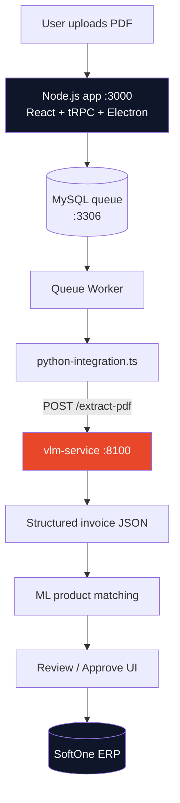
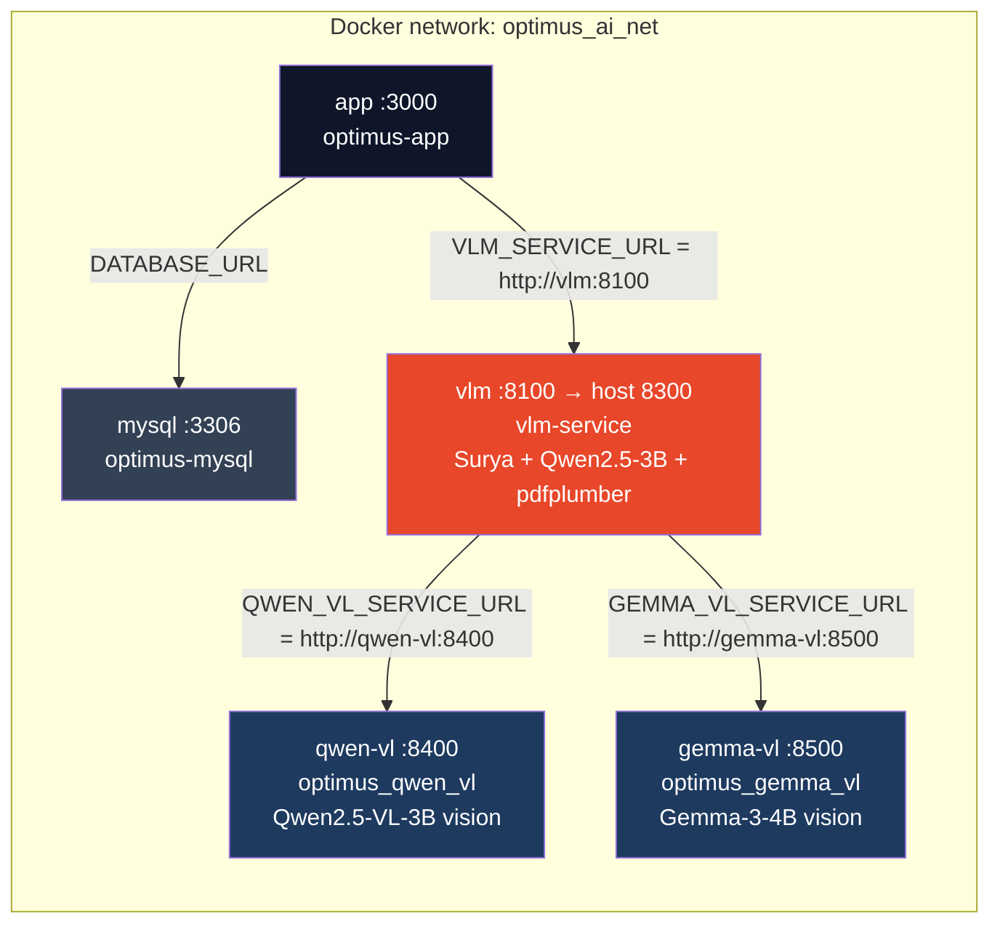
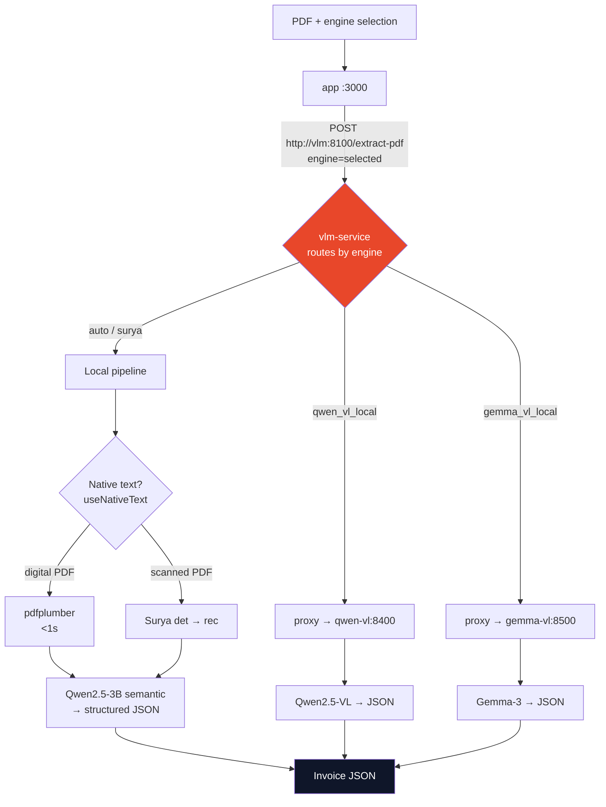
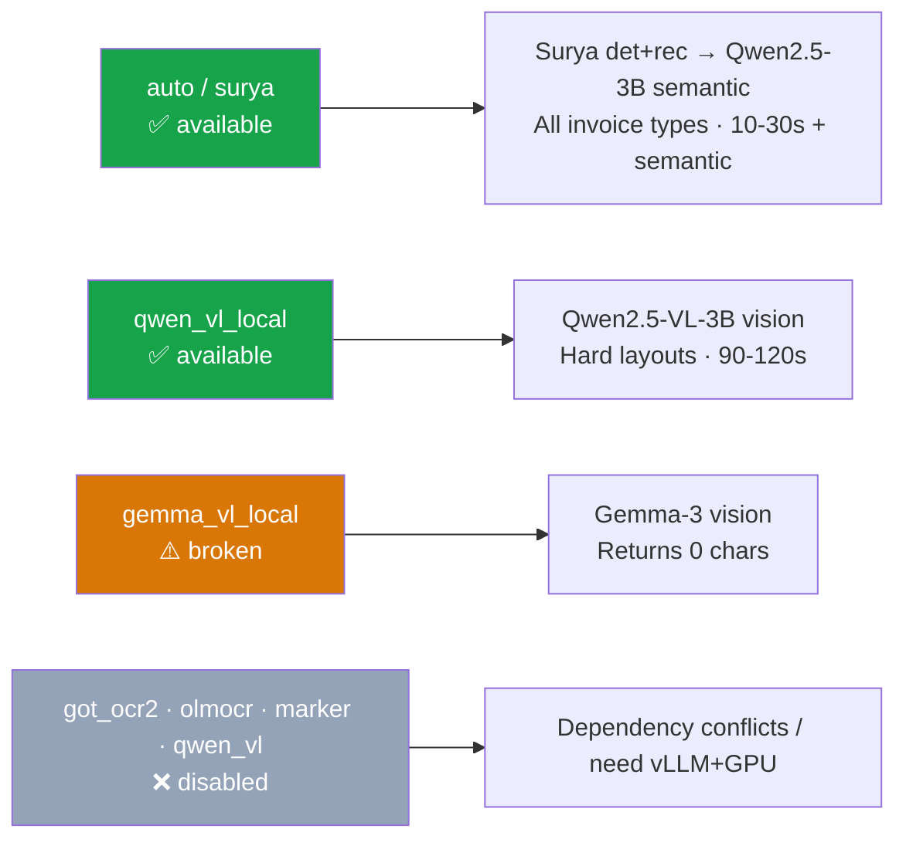
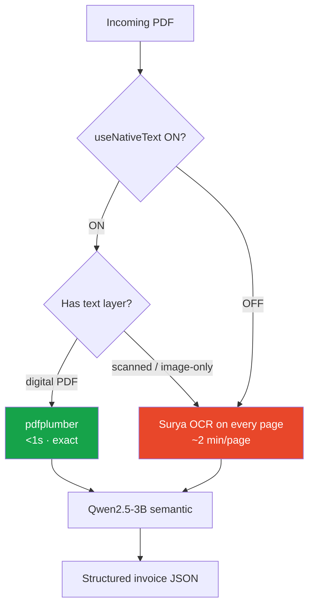
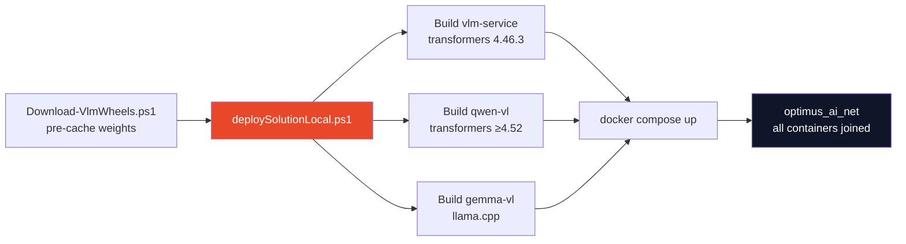

# OptimusInvoice — VLM / AI Extraction Stack

> **Optimus Invoice Automation** — Powered by **Optimus Research**
> AI-driven supplier-invoice extraction: OCR + vision models → structured invoice JSON → ERP posting.

This README documents the AI/extraction architecture: the containers, the models (with versions), how a PDF is routed to an engine, and how to run it.

---

## Table of Contents

1. [System Overview](#1-system-overview)
2. [Container Topology](#2-container-topology)
3. [Request Routing](#3-request-routing)
4. [Models & Versions](#4-models--versions)
5. [Engine Selection](#5-engine-selection)
6. [Scanned vs Text-based PDFs](#6-scanned-vs-text-based-pdfs)
7. [Configuration & Tuning](#7-configuration--tuning)
8. [Deployment](#8-deployment)
9. [Known Issues](#9-known-issues)

---

## 1. System Overview



Optimus runs **two incompatible AI stacks side-by-side** in separate Docker
containers, because Surya OCR and the vision-language models require mutually
exclusive versions of HuggingFace `transformers`.

| Stack | `transformers` | Engines |
|---|---|---|
| **vlm-service** | `== 4.46.3` | `auto`, `surya` |
| **vision (qwen-vl / gemma-vl)** | `>= 4.52` | `qwen_vl_local`, `gemma_vl_local` |

> **Why split?** Surya OCR `0.6.13` pins `transformers==4.46.3`. Qwen2.5-VL and
> Gemma-3 require `transformers>=4.52`. They cannot coexist in one Python
> environment — separate containers are the only clean solution.

---

## 2. Container Topology



| Service | Container | Internal port | Host port | Role |
|---|---|---|---|---|
| `app` | `optimus-app` | 3000 | 3000 | React UI + tRPC API + queue worker |
| `mysql` | `optimus-mysql` | 3306 | 3306 | Database + processing queue |
| `vlm` | `vlm-service` | **8100** | 8300 | Surya OCR + Qwen2.5-3B semantic + pdfplumber + dispatcher |
| `qwen-vl` | `optimus_qwen_vl` | 8400 | 8400 | Qwen2.5-VL-3B vision model |
| `gemma-vl` | `optimus_gemma_vl` | 8500 | 8500 | Gemma-3-4B vision model |

> **Port note:** the `vlm` container **listens internally on 8100**; the host
> mapping `8300:8100` exposes it on 8300 for tools outside Docker. Inside the
> network, services call it at `http://vlm:8100`. The host-facing 8300 is only
> for direct access from your machine.

---

## 3. Request Routing



The app **always** POSTs to `vlm-service` (`http://vlm:8100/extract-pdf`). The
`vlm-service` then either handles the request locally (`auto`/`surya`) or proxies
it over the Docker network to the vision container that matches the selected
engine.

---

## 4. Models & Versions

### `vlm-service` (port 8100) — `transformers==4.46.3`

| Model | Version / ID | Type | Size | Speed (CPU) | Framework |
|---|---|---|---|---|---|
| **Surya detection** | `vikp/surya_det3` | EfficientViT semantic segmentation | ~300 MB | ~5 s / page | PyTorch (Surya 0.6.13) |
| **Surya recognition** | `vikp/surya_rec2` | DonutSwin encoder + OCR decoder | ~200 MB | ~100 s / 2 batches | PyTorch (Surya 0.6.13) |
| **Semantic LLM** | `Qwen2.5-3B-Instruct` GGUF, **Q4_K_M** (4-bit) | Causal LLM (text → JSON) | 2.1 GB | ~344 s / invoice | llama-cpp-python |
| **Native text** | `pdfplumber` | Rule-based (no ML) | < 1 MB | < 1 s | Python library |

- **Surya languages:** Greek + English (`SURYA_LANGS=el,en`)
- **Semantic fallback:** a regex parser activates if Qwen2.5-3B times out
- **Context window:** `LLAMA_N_CTX=4096` (raised from 2048 — 2048 truncated JSON on long invoices)

### `qwen-vl` (port 8400) — `transformers>=4.52`

| Model | Version / ID | Type | Size | Speed (CPU) | Load time |
|---|---|---|---|---|---|
| **Qwen2.5-VL-3B** | `Qwen/Qwen2.5-VL-3B-Instruct` | Vision-Language (image → JSON) | 7.3 GB (2 safetensors shards) | ~90–120 s | ~120–150 s first request |

- Class: `Qwen2_5_VLForConditionalGeneration`
- Reads the invoice **directly as an image** — no separate OCR step
- Offline: `HF_HUB_OFFLINE=1` (weights pre-cached on host via `Download-VlmWheels.ps1`)

### `gemma-vl` (port 8500) — llama.cpp / GGUF

| Model | Version / ID | Type | Size | Speed (CPU) | Status |
|---|---|---|---|---|---|
| **Gemma-3-4B-it** | `ggml-org/gemma-3-4b-it-GGUF`, **Q4_K_M** | Vision-Language (image → JSON) | ~2.5 GB model + 851 MB mmproj (f16) | ~60–90 s (target) | ⚠️ **returns 0 chars — see [Known Issues](#9-known-issues)** |

- Files: `gemma-3-4b-it-Q4_K_M.gguf` + `mmproj-model-f16.gguf`
- Gated model — needs HuggingFace license acceptance + `HF_TOKEN`
- Embedded `Gemma3ChatHandler` (llama.cpp PR #1989 backport)

### Storage locations

| Model | Location | Notes |
|---|---|---|
| Surya det + rec | Docker volume `vlm-cache` | Auto-downloaded on first start |
| Qwen2.5-3B GGUF | Bind mount `./model_cache/llama` | `LLAMA_CACHE_DIR` — survives `down -v` |
| Qwen2.5-VL-3B | Host `./model_cache/` → `/models` | Pre-download via `Download-VlmWheels.ps1` |
| Gemma-3-4B | Host `./model_cache/` → `/models` | Explicit GGUF paths bypass HF hub lookup |

---

## 5. Engine Selection

Configured in **Settings → VLM / AI Extraction Engines**. Only the engines below
are usable in the current two-container architecture; the rest are disabled in
the UI.



| Engine | Models invoked | Best for | Status |
|---|---|---|---|
| `auto` | Surya det → rec → Qwen2.5-3B GGUF | Default — all invoice types | ✅ |
| `surya` | Same as `auto` | Explicit Surya pipeline | ✅ |
| `qwen_vl_local` | Qwen2.5-VL-3B (vision) | Scanned / complex layouts | ✅ |
| `gemma_vl_local` | Gemma-3-4B (vision) | (intended alt vision engine) | ⚠️ 0 chars |
| `got_ocr2` | — | high-accuracy OCR | ❌ conflicts with `transformers≥4.52` |
| `olmocr` | — | structured JSON | ❌ needs vLLM + GPU |
| `marker` | — | mixed PDF → Markdown | ❌ dependency conflict |
| `qwen_vl` (vLLM) | — | visual Q&A | ❌ needs vLLM + GPU |

---

## 6. Scanned vs Text-based PDFs

The single most important routing switch is the **Native text extraction
(pdfplumber)** toggle (`useNativeText`) in **Settings → PDF Extraction**:



- **ON (recommended):** digital PDFs (New Relic, Adobe, Fiverr, Avise) are read
  directly by pdfplumber — **instant and perfectly accurate**. Scanned PDFs
  automatically fall through to Surya.
- **OFF:** Surya OCR runs on every invoice regardless of type — consistent
  visual processing but ~2 min/page on CPU.

The vision engines (`qwen_vl_local`, `gemma_vl_local`) ignore this toggle —
they read the page **as an image** and skip OCR entirely.

---

## 7. Configuration & Tuning

Key environment variables (set in `docker-compose.yml`):

| Variable | Value | Applies to | Purpose |
|---|---|---|---|
| `VLM_SERVICE_URL` | `http://vlm:8100` | app | Where the app calls the VLM service |
| `VLM_ENGINE` | `surya` (default) | app | Default extraction engine |
| `VLM_TIMEOUT` | `600000` (10 min) | app | Max wait for extraction |
| `SURYA_LANGS` | `el,en` | vlm | OCR languages (Greek + English) |
| `SEMANTIC_MODEL` | `qwen2.5:3b` | vlm | Semantic extraction LLM |
| `LLAMA_N_CTX` | `4096` | vlm / gemma | Context window (≥4096 avoids JSON truncation) |
| `LLAMA_N_THREADS` | `10` | vlm / gemma | CPU threads (10 of 12 cores) |
| `LLAMA_N_BATCH` | `512` | vlm / gemma | Tokens per batch |
| `HF_HUB_OFFLINE` | `1` | vision | Strictly offline — cache must be primed |
| `MAX_PAGES` | `10` | vlm | Page cap per document |

> **Hardware baseline:** CPU-only, 12 cores / 64 GB RAM. No GPU required.

---

## 8. Deployment

```powershell
# One-time: pre-download vision model weights (~10 GB: Qwen 7.3 GB + Gemma 3.3 GB)
.\Download-VlmWheels.ps1

# Full deploy — builds all containers, starts everything
.\deploySolutionLocal.ps1
```



**First-start model load times** (cold): vlm-service ~8 min (Surya ~3.5 + semantic
~4), qwen-vl ~5–11 min, gemma-vl ~8 min. Subsequent starts are faster (weights
cached). The app waits for the VLM service to report healthy before processing.

---

## 9. Known Issues

| Issue | Status | Notes |
|---|---|---|
| **`gemma_vl_local` returns 0 chars** | 🔴 Open | Gemma container loads successfully but the engine produces empty output on extraction. `qwen_vl_local` covers the vision use-case in the meantime. |
| Multi-unit quantity parsing (1437 → 1) | 🟡 Fix delivered | `_normalize_number()` in `semantic_extractor.py`; verify on a multi-unit invoice after rebuild. |
| VLM warm-up after host sleep | 🟢 Fixed | Worker defers invoices (no-penalty re-queue) until VLM is ready; healthcheck switched curl→python. |

---

*Optimus Invoice Automation — Powered by Optimus Research*
*Navy `#0f1629` · Coral `#E8472A`*
