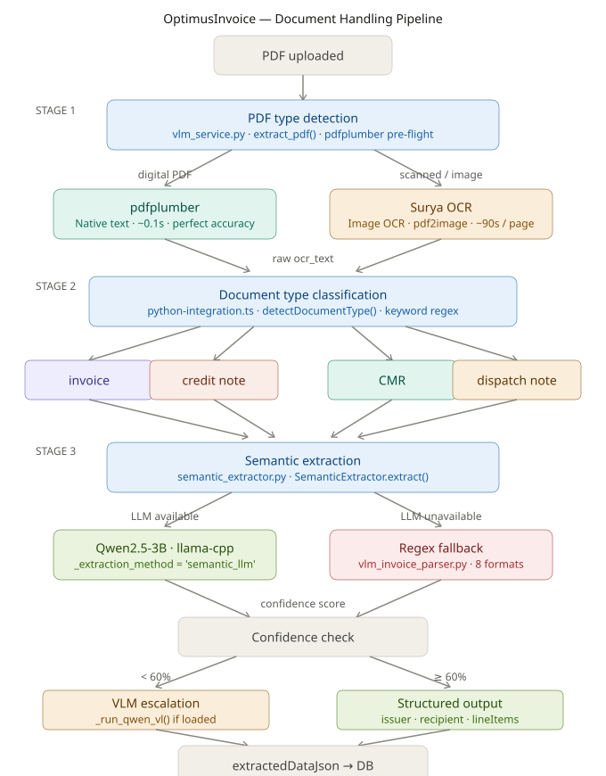
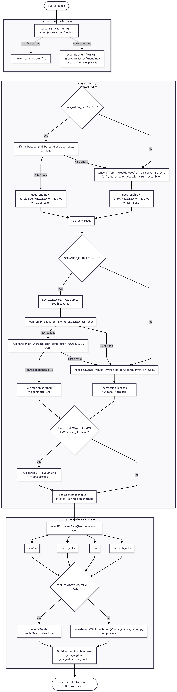

# OptimusInvoice — Document Handling Architecture

Complete pipeline trace from PDF upload to structured JSON, verified against source code.

---

## Conceptual Architecture Diagram

---

---

## Code Flow Diagram


---

## Stage 1 — Entry Point (Node → Docker)

**File:** `server/python-integration.ts`

### Health check before processing

Every `classifyAndExtract()` call starts with a mandatory health check.
If the Docker container is not running, it throws immediately — no silent fallback.

```typescript
// python-integration.ts
const vlmStatus = await getVlmStatus();   // GET :8300/health, 5s timeout
if (!vlmStatus) {
    throw new Error(
        "[VLM] SLM service is not available at " + VLM_SERVICE_URL + ".\n" +
        "Start it with:  docker-compose -f docker-compose.vlm.yml up -d"
    );
}
```

### Sending the PDF

`getVlmOcrText()` posts the raw PDF bytes as multipart form data to `/extract-pdf`.
Two parameters control the pipeline inside Docker:

```typescript
// python-integration.ts — getVlmOcrText()
formData.append("engine",          engine);               // "surya" | "got_ocr2" | "auto"
formData.append("extract_invoice", "1");                  // triggers semantic extraction
formData.append("use_native_text", useNativeText ? "1" : "0");  // pdfplumber pre-flight
```

`useNativeText` is read from the user's saved settings in `routers.ts` before calling
`classifyAndExtract()`, and maps to the **Native text extraction** toggle in
Configuration → PDF Extraction Settings.

---

## Stage 2 — PDF Type Detection (Docker)

**File:** `vlm-service/app.py` → `async def extract_pdf()`

### Path A — pdfplumber (digital PDFs)

Only runs when `use_native_text="1"` is received. Reads embedded Unicode text
directly from the PDF — no image conversion, no OCR.

```python
# vlm_service.py
if use_native_text.lower() in ("1", "true", "yes"):
    import pdfplumber as _pdfplumber, io as _io
    with _pdfplumber.open(_io.BytesIO(pdf_bytes)) as _pdf:
        _pages_text = [p.extract_text() or "" for p in _pdf.pages[:MAX_PAGES]]
    _plumber_text = "\n\n".join(t for t in _pages_text if t.strip())
    if len(_plumber_text.strip()) > 50:          # threshold: 50 chars
        ocr_text    = _plumber_text
        used_engine = "pdfplumber"               # Surya is skipped entirely
```

**Result:** `~0.1s`, perfect Unicode accuracy including Greek (ΑΦΜ, ΔΟΥ, ΜΑΡΚ).

### Path B — Surya OCR (scanned / image PDFs)

Fires when pdfplumber is disabled OR returned fewer than 50 chars.

```python
# vlm_service.py
if not ocr_text:                                 # pdfplumber found nothing useful
    from pdf2image import convert_from_bytes
    images = convert_from_bytes(pdf_bytes, dpi=200)
    parts  = []
    for img in images[:MAX_PAGES]:
        buf = io.BytesIO()
        img.save(buf, format="PNG")
        img_b64 = base64.b64encode(buf.getvalue()).decode()
        res = _run_surya(img_b64, "el")          # Greek + English
        parts.append(res.get("text", ""))
    ocr_text    = "\n\n".join(p for p in parts if p)
    used_engine = "surya"
```

`_run_surya()` uses the **Surya 0.6.x API**:

```python
# vlm_service.py — _run_surya()
from surya.detection import batch_text_detection
from surya.ocr       import run_recognition

det_result = batch_text_detection([img], det_model, det_processor)
bboxes     = [[b.bbox for b in det_result[0].bboxes]]
rec_result = run_recognition([img], [["el"]], rec_model, rec_processor, bboxes=bboxes)
# → lines with .text and .confidence per detected text region
```

**Result:** ~90s/page on CPU at 200 DPI.

### Extraction method tagging

Both paths write `extraction_method` into the response payload.
This flows back to Node, into `extractedDataJson._vlm_extraction_method`,
and is displayed as a badge in the Invoice Detail panel:

```python
# vlm_service.py
"extraction_method": (
    "native_text"  if used_engine == "pdfplumber"              else
    "ocr_image"    if used_engine in ("surya", "got_ocr2")     else
    "vlm"          if used_engine in ("qwen_vl", "olmocr")     else
    "unknown"
),
```

| `extraction_method` | UI badge | Meaning |
|---|---|---|
| `native_text` | 📄 Text PDF | pdfplumber read embedded text |
| `ocr_image` | 🔍 Surya | Image OCR via Surya 0.6.x |
| `vlm` | 🤖 VLM | vLLM-based model (Qwen-VL / olmOCR) |

---

## Stage 3 — Semantic Extraction (Docker)

**File:** `vlm-service/app.py` + `vlm-service/semantic_extractor.py`

Runs immediately after OCR, inside the same `/extract-pdf` request.
Only fires when `extract_invoice="1"` is passed (always set by Node).

### Entry — wait for model if still loading

On first boot after a new container the model downloads (~2 GB).
A 30-second wait prevents the first invoice from falling back to regex
during the download window:

```python
# vlm_service.py — inside extract_pdf()
if SEMANTIC_ENABLED:
    extractor = get_extractor()                   # singleton SemanticExtractor
    if not extractor.is_loaded() and extractor.is_available():
        for _ in range(30):
            await asyncio.sleep(1)
            if extractor.is_loaded():
                break
    loop = asyncio.get_event_loop()
    result["invoice"] = await loop.run_in_executor(
        None, extractor.extract, ocr_text         # blocking call → thread pool
    )
```

### SemanticExtractor.extract()

**File:** `vlm-service/semantic_extractor.py` → `class SemanticExtractor`

```python
# semantic_extractor.py — SemanticExtractor.extract()
def extract(self, ocr_text: str) -> Dict[str, Any]:
    if not SEMANTIC_ENABLED or not self.is_available():
        return self._regex_fallback(ocr_text)     # llama-cpp-python not installed

    if self._llm is None and not self.load():
        return self._regex_fallback(ocr_text)     # model file missing / load failed

    try:
        raw_json = self._run_inference(ocr_text)  # Qwen2.5-3B inference
        result   = self._parse_response(raw_json) # JSON parse + normalise
        result["_extraction_method"] = "semantic_llm"
        return result
    except Exception:
        return self._regex_fallback(ocr_text)     # any inference failure
```

### Qwen2.5-3B inference

Model: `Qwen/Qwen2.5-3B-Instruct-GGUF` Q4_K_M, ~2 GB,
cached in the `llama-models` Docker volume, loads in ~1.2s after first download.

```python
# semantic_extractor.py — SemanticExtractor._run_inference()
def _run_inference(self, text: str) -> str:
    capped = text[:5000]                          # cap to context window
    prompt = EXTRACTION_PROMPT.replace("{TEXT}", capped)
    response = self._llm.create_chat_completion(
        messages=[
            {"role": "system", "content": SYSTEM_PROMPT},
            {"role": "user",   "content": prompt},
        ],
        max_tokens  = 1500,
        temperature = 0.0,                        # deterministic
        stop        = ["```", "\n\n\n"],
    )
    return response["choices"][0]["message"]["content"]
```

The model is loaded once at startup via `llama_cpp.Llama`:

```python
# semantic_extractor.py — SemanticExtractor.load()
from llama_cpp import Llama
self._llm = Llama(
    model_path   = str(model_path),
    n_ctx        = LLAMA_N_CTX,       # 4096
    n_threads    = LLAMA_N_THREADS,   # 4
    n_gpu_layers = 0,                 # CPU only
    use_mlock    = True,              # keep in RAM
)
```

### Response parsing

`_parse_response()` strips markdown fences, extracts the JSON object,
normalises all numeric fields, and populates legacy keys for backward compat:

```python
# semantic_extractor.py — SemanticExtractor._parse_response()
data["supplier"]        = issuer.get("name")
data["supplierAddress"] = issuer.get("address")
data["supplierVat"]     = issuer.get("vatNumber")
data["client"]          = recipient.get("name")
data["clientVat"]       = recipient.get("vatNumber")
data["confidence"]         = min(score, 100)    # 80 base + items/totals bonuses
data["_extraction_method"] = "semantic_llm"
```

### Available models (SEMANTIC_MODEL env var)

| Key | Model | VRAM / RAM | Inference (CPU) |
|---|---|---|---|
| `qwen2.5:3b` ← default | Qwen2.5-3B-Instruct Q4_K_M | ~2 GB | ~30–50s |
| `qwen2.5:7b` | Qwen2.5-7B-Instruct Q4_K_M | ~4.5 GB | ~90s |
| `phi3.5:mini` | Phi-3.5-mini-instruct Q4_K_M | ~2.5 GB | ~25s |
| `llama3.2:3b` | Llama-3.2-3B-Instruct Q4_K_M | ~2.5 GB | ~40s |
| `mistral:7b` | Mistral-7B-Instruct Q4_K_M | ~4.5 GB | ~90s |

---

## Stage 4 — Regex Fallback

**File:** `vlm-service/vlm_invoice_parser.py` → `parse_invoice_fields()`

Activated when:
- `SEMANTIC_ENABLED = 0`
- `llama-cpp-python` not installed
- Model file missing / download failed
- Qwen inference raises any exception
- `_parse_response()` finds no valid JSON

```python
# semantic_extractor.py — SemanticExtractor._regex_fallback()
def _regex_fallback(self, text: str) -> Dict[str, Any]:
    from vlm_invoice_parser import parse_invoice_fields
    result = parse_invoice_fields(text)
    result["_extraction_method"] = "regex_fallback"
    return result
```

### Supported invoice formats

`parse_invoice_fields()` tries 8 format patterns in order:

| Format | Detection signal | Example supplier |
|---|---|---|
| **A0** | Numbered rows + `pcs` unit + `EUR` price | Bulgarian dual-currency (Travel Services) |
| **A** | 6-digit supplier code + `EA` unit + tax% column | Adobe |
| **B** | `price EUR x qty discount subtotal` pattern | Trengo |
| **C** | `description qty price total` (no unit column) | Fiverr |
| **C2** | Surya vertical column read (desc then numbers) | Fiverr (OCR artefact) |
| **D** | `N. description\nqty pcs price EUR` multiline | Generic service |
| **E** | `description … $amount` at line end | New Relic / usage-based |
| **F** | `description qty price total` large-qty rows | Pharos GBP |

### Issuer fields extracted by regex

```python
# vlm_invoice_parser.py — parse_invoice_fields()
# Extracted for issuer{}:
#   name           — company suffix detection (LTD, SA, AE, EOOD ...)
#   vatNumber      — ΑΦΜ / VAT No / Company ID patterns
#   registrationNumber — ΓΕΜΗ / Reg. No / Company no
#   address        — Address: / Διεύθυνση:
#   city + postCode — 5-digit Greek postcode pattern
#   country        — keyword hints (Greece, Bulgaria, Israel ...)
#   doy            — ΔΟΥ / Δ.Ο.Υ.
#   profession     — Επάγγελμα / Activity
#   manager        — Manager <name>
#   phone          — Tel / Τηλ / Phone
#   email          — RFC-5321 pattern
#   iban           — /[A-Z]{2}\d{2}[\w\d]{4,}/
#   swift          — 8 or 11 char all-caps (filtered against common words)
#   bank           — Bank / Τράπεζα / PIRAEUS / ALPHA ...
```

### Confidence scoring

Both paths (Qwen and regex) compute a `confidence` score stored in the extraction:

```python
# vlm_invoice_parser.py — end of parse_invoice_fields()
score = 40
if inv.get("invoiceNumber"): score += 15
if inv.get("invoiceDate"):   score += 10
if inv.get("supplier"):      score += 10
if inv.get("total"):         score += 10
if line_items:               score += 15
inv["confidence"] = min(score, 100)

# semantic_extractor.py — _parse_response()
score = 80                              # higher base for LLM path
if clean_items:           score += 10
if data.get("total"):     score += 5
if issuer.get("name"):    score += 3
if recipient.get("name"): score += 2
data["confidence"] = min(score, 100)
```

---

## Stage 5 — Document Classification & Final Assembly (Node)

**File:** `server/python-integration.ts`

### Document type detection

Runs on the raw OCR text — pure TypeScript, no subprocess:

```typescript
// python-integration.ts — detectDocumentType()
function detectDocumentType(text: string): ClassificationResult["documentType"] {
    const t = text.toUpperCase();
    if (/\bCREDIT\s+NOTE\b|\bΠΙΣΤΩΤΙΚΟ\b/.test(t))           return "credit_note";
    if (/\bCMR\b|\bCONSIGNMENT\b/.test(t))                    return "cmr";
    if (/\bDELIVERY\s+NOTE\b|\bΔΕΛΤΙΟ\s+ΑΠΟΣΤΟΛΗΣ\b/.test(t)) return "dispatch_note";
    return "invoice";                                           // default
}
```

> **Greek combined documents** — "Τιμολόγιο Πώλησης - Δελτίο Αποστολής" does not
> contain the standalone `ΔΕΛΤΙΟ ΑΠΟΣΤΟΛΗΣ` pattern, so it correctly routes as `invoice`.

### Structured output routing

Node checks whether Docker already returned a fully parsed object
(Qwen path) or only raw text (regex fallback or Qwen unavailable):

```typescript
// python-integration.ts — classifyAndExtract()
const structured = result.invoice || result.structured || null;

// ...

if (vlmResult.structured && Object.keys(vlmResult.structured).length > 2) {
    // Qwen returned a parsed object — use it directly
    invoiceFields = vlmResult.structured;
} else {
    // Raw text only — run vlm_invoice_parser.py as a subprocess fallback
    invoiceFields = await parseInvoiceWithVlmParser(vlmResult.text);
}
```

### VLM escalation (optional)

Only fires when **both** are true:
1. `items_found == 0` OR `confidence < 60 AND items_found < 3`
2. `"qwen_vl" in _models` (vLLM container running with Qwen-VL loaded)

In practice this path does not fire on CPU-only deployments.

```python
# vlm_service.py
need_escalation = (items_found == 0) or (confidence < 60 and items_found < 3)
if need_escalation and "qwen_vl" in _models:
    vlm_result = await _run_qwen_vl(vlm_b64, vlm_prompt, None, 1500)
    if len(vlm_items) > items_found:
        result["invoice"]["lineItems"]     = vlm_items
        result["invoice"]["vlm_escalated"] = True
```

### Final extraction object

Node assembles the unified `extraction` dict that is stored in `extractedDataJson`:

```typescript
// python-integration.ts — classifyAndExtract()
const extraction = {
    success:      true,
    documentType: classification.documentType,
    invoiceNumber, invoiceDate, supplier, client, clientVat,
    issuer:       invoiceFields.issuer    ?? null,
    recipient:    invoiceFields.recipient ?? null,
    orderNumber:  invoiceFields.orderNumber ?? null,
    lineItems:    [...],
    totals:       { subtotal, vat, total },
    currency:     invoiceFields.currency ?? "EUR",
    // Audit trail
    _vlm_used:               true,
    _vlm_engine:             vlmResult.engine,
    _vlm_extraction_method:  vlmResult.extractionMethod ?? "unknown",
    _vlm_raw_text:           vlmResult.text,
    _vlm_structured:         vlmResult.structured ?? null,
};
```

---

## Complete Call Chain

```
routers.ts
  reads: settingsJson.vlmEngine, settingsJson.useNativeText
    └── classifyAndExtract(pdfPath, engine, useNativeText)
          │
          ├── getVlmStatus()
          │     GET http://localhost:8300/health
          │
          └── getVlmOcrText(pdfPath, engine, useNativeText)
                POST http://localhost:8300/extract-pdf
                form: file · engine · extract_invoice=1 · use_native_text
                │
                │  vlm_service.py — extract_pdf()
                │  ├── [use_native_text=1] pdfplumber.open() → extract_text()
                │  ├── [fallback]          convert_from_bytes() → _run_surya()
                │  │     surya: batch_text_detection + run_recognition
                │  │
                │  └── [extract_invoice=1]
                │        semantic_extractor.py — SemanticExtractor.extract()
                │        ├── llama_cpp.Llama.create_chat_completion()   [primary]
                │        │     Qwen2.5-3B-Instruct-GGUF Q4_K_M
                │        └── vlm_invoice_parser.parse_invoice_fields()  [fallback]
                │              8 regex format patterns
                │
                returns: { ocr_text, invoice, extraction_method, elapsed_seconds }
                │
          ├── detectDocumentType(text)           keyword regex
          ├── vlmResult.structured → invoiceFields   (Qwen path)
          │   OR parseInvoiceWithVlmParser(text)     (regex subprocess)
          └── build extraction object → return
```

---

## Environment Variables

| Variable | Default | Description |
|---|---|---|
| `SEMANTIC_ENABLED` | `1` | `0` = disable Qwen, use regex only |
| `SEMANTIC_MODEL` | `qwen2.5:3b` | Key from `MODEL_REGISTRY` in `semantic_extractor.py` |
| `SEMANTIC_TIMEOUT` | `120` | Seconds before inference times out |
| `LLAMA_CACHE_DIR` | `/root/.cache/llama` | GGUF model location (Docker volume `llama-models`) |
| `LLAMA_N_CTX` | `4096` | Context window (model max: 32768) |
| `LLAMA_N_THREADS` | `4` | CPU threads for llama.cpp |
| `MAX_PAGES` | `10` | Maximum PDF pages processed |
| `VLM_ENGINE` | `surya` | Default OCR engine |
| `VLM_TIMEOUT` | `300000` | Node HTTP timeout for `/extract-pdf` (ms) |
| `VLM_SERVICE_URL` | `http://localhost:8300` | Docker container URL |

---

## File Map

```
vlm-service/
├── app.py                    ← extract_pdf() — full pipeline orchestrator
├── semantic_extractor.py     ← SemanticExtractor — Qwen2.5-3B via llama-cpp
├── vlm_invoice_parser.py     ← parse_invoice_fields() — 8-format regex parser
└── Dockerfile                ← llama-cpp-python (CPU) + Surya + pdfplumber

server/
├── python-integration.ts     ← classifyAndExtract() — Node↔Docker bridge
├── routers.ts                ← reads config, calls classifyAndExtract()
└── python/
    ├── vlm_service.py        ← mirror of vlm-service/app.py (auto-synced)
    ├── semantic_extractor.py ← mirror (manual sync)
    └── vlm_invoice_parser.py ← mirror (manual sync)
```

> **Sync rule:** edit `server/python/vlm_service.py` — the deploy script copies it
> to `vlm-service/app.py` automatically. For `semantic_extractor.py` and
> `vlm_invoice_parser.py`, copy manually before running `.\deploySolutionLocal.ps1`.
