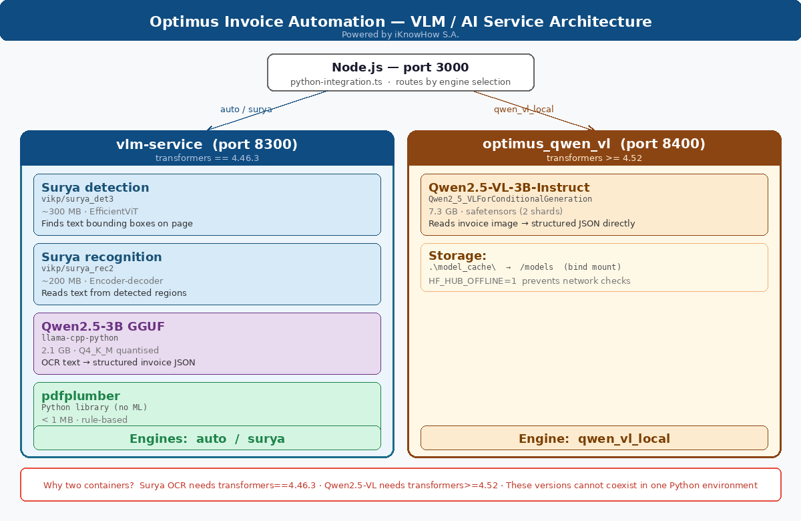

# VLM / AI Service Architecture

> **Optimus Invoice Automation** — Powered by iKnowHow S.A.

This document describes the two-container AI pipeline that powers invoice extraction.

---

## Architecture Overview



Optimus uses **two separate Docker containers** to run two incompatible AI stacks side by side:

| | `vlm-service` | `optimus_qwen_vl` |
|---|---|---|
| **Port** | 8300 | 8400 |
| **transformers** | `== 4.46.3` | `>= 4.52` |
| **Engines** | `auto`, `surya` | `qwen_vl_local` |

> **Why two containers?** Surya OCR 0.6.13 requires `transformers==4.46.3`. Qwen2.5-VL-3B requires `transformers>=4.52`. These versions are mutually exclusive in a single Python environment — splitting them into separate containers is the only clean solution.

---

## Request Routing

All requests go through **Node.js (port 3000)** → always POST to `vlm-service:8300` → routed internally:

```
User upload
    │
    ▼
Node.js :3000  (python-integration.ts)
    │
    ▼  POST /extract-pdf  engine=<selected>
    │
vlm-service :8300
    ├── engine = auto / surya  →  handled locally (Surya + Qwen2.5-3B)
    └── engine = qwen_vl_local →  proxied via httpx to optimus_qwen_vl:8400
```

The two containers communicate over the shared `optimus_ai_net` Docker network using their container names as hostnames.

---

## Models

### `vlm-service` — port 8300

#### Surya detection — `vikp/surya_det3`
- **Architecture:** EfficientViT semantic segmentation
- **Task:** finds text bounding boxes and regions on each invoice page
- **Size:** ~300 MB
- **Speed:** ~5 seconds per page on CPU
- **Storage:** Docker volume `vlm-cache` (auto-downloaded on first start)
- **Requires:** `transformers==4.46.3`

#### Surya recognition — `vikp/surya_rec2`
- **Architecture:** Encoder-decoder (DonutSwin encoder + custom OCR decoder)
- **Task:** reads the actual text from the bounding boxes found by detection
- **Size:** ~200 MB
- **Speed:** ~100 seconds for 2 batches on CPU
- **Languages:** Greek + English (`SURYA_LANGS=el,en`)
- **Storage:** Docker volume `vlm-cache`
- **Requires:** `transformers==4.46.3` — breaks silently with 4.52+

#### Qwen2.5-3B-Instruct GGUF — `llama-cpp-python`
- **Architecture:** Causal LLM, 3B parameters, Q4\_K\_M 4-bit quantised
- **Task:** semantic extraction — converts raw Surya OCR text into structured invoice JSON (supplier, number, date, line items, totals, VAT)
- **Size:** 2.1 GB
- **Speed:** ~344 seconds on CPU for a full invoice
- **Storage:** Docker volume `llama-models` (auto-downloaded on first start)
- **Framework:** llama-cpp-python (pure CPU, no GPU required)
- **Fallback:** regex parser activates if Qwen times out or is unavailable

#### pdfplumber
- **Type:** Rule-based Python library — no ML model
- **Task:** extracts text directly from digitally-generated PDFs (Avise, Adobe, etc.)
- **Size:** < 1 MB
- **Speed:** < 1 second
- **When used:** pre-flight for `auto`/`surya` engines on digital PDFs; falls back to Surya OCR automatically for scanned/image-only PDFs

---

### `optimus_qwen_vl` — port 8400

#### Qwen2.5-VL-3B-Instruct
- **Architecture:** Vision-Language Model — `Qwen2_5_VLForConditionalGeneration`
- **Task:** reads the invoice **directly as an image** — no separate OCR step needed — and outputs structured JSON
- **Size:** 7.3 GB (safetensors, 2 shards: `model-00001-of-00002.safetensors` + `model-00002-of-00002.safetensors`)
- **Speed:** ~90–120 seconds on CPU after model is loaded into memory
- **Model load time:** ~120–150 seconds on first request (weights already on disk)
- **Storage:** host directory `.\model_cache\` bind-mounted to `/models` inside the container
- **Pre-download:** run `.\Download-VlmWheels.ps1` (step 7) to download the ~7.3 GB before first deploy
- **Requires:** `transformers>=4.52` for `Qwen2_5_VLForConditionalGeneration`
- **Offline mode:** `HF_HUB_OFFLINE=1` prevents HuggingFace network checks at startup

---

## Model Comparison

| Model | Type | Size | Speed (CPU) | Framework | Engine |
|---|---|---|---|---|---|
| `vikp/surya_det3` | Detection CNN | ~300 MB | ~5s / page | PyTorch / ONNX | `auto`, `surya` |
| `vikp/surya_rec2` | Encoder-decoder OCR | ~200 MB | ~100s / page | PyTorch | `auto`, `surya` |
| `Qwen2.5-3B GGUF` | LLM — text extraction | 2.1 GB | ~344s | llama-cpp-python | `auto`, `surya` |
| `Qwen2.5-VL-3B` | Vision-Language | 7.3 GB | ~90–120s | transformers 4.52 | `qwen_vl_local` |
| `pdfplumber` | Rule-based | < 1 MB | < 1s | Python library | `auto`, `surya` |

---

## Engine Selection

Configure in **Settings → VLM / AI Extraction Engines**:

| Engine | Models invoked | Best for |
|---|---|---|
| `auto` | Surya det → Surya rec → Qwen2.5-3B GGUF | Default — all invoice types |
| `surya` | Same as `auto` | Explicit Surya pipeline |
| `qwen_vl_local` | Qwen2.5-VL-3B (vision) | Scanned invoices, complex layouts |

---

## Model Storage

| Model | Location | Notes |
|---|---|---|
| Surya det + rec | Docker volume `vlm-cache` | Auto-downloaded on first container start |
| Qwen2.5-3B GGUF | Docker volume `llama-models` | Auto-downloaded on first start via huggingface_hub |
| Qwen2.5-VL-3B | `.\model_cache\` on host | Pre-downloaded by `Download-VlmWheels.ps1`. Set `HF_HUB_OFFLINE=1` after download. |

---

## Deployment

```powershell
# One-time: pre-download Qwen2.5-VL-3B weights (~7.3 GB)
.\Download-VlmWheels.ps1

# Full deploy — builds both containers, starts everything
.\deploySolutionLocal.ps1
```

`deploySolutionLocal.ps1` builds and starts both containers sequentially:
- **Step 5a** — builds `vlm-service` with `transformers==4.46.3`
- **Step 5b** — builds `optimus_qwen_vl` with `transformers>=4.52`

Both containers join the `optimus_ai_net` Docker network automatically.

---

*Optimus Invoice Automation — Powered by iKnowHow S.A.*